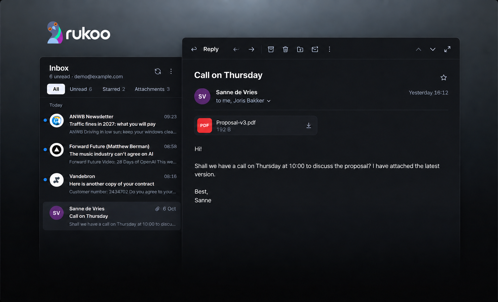
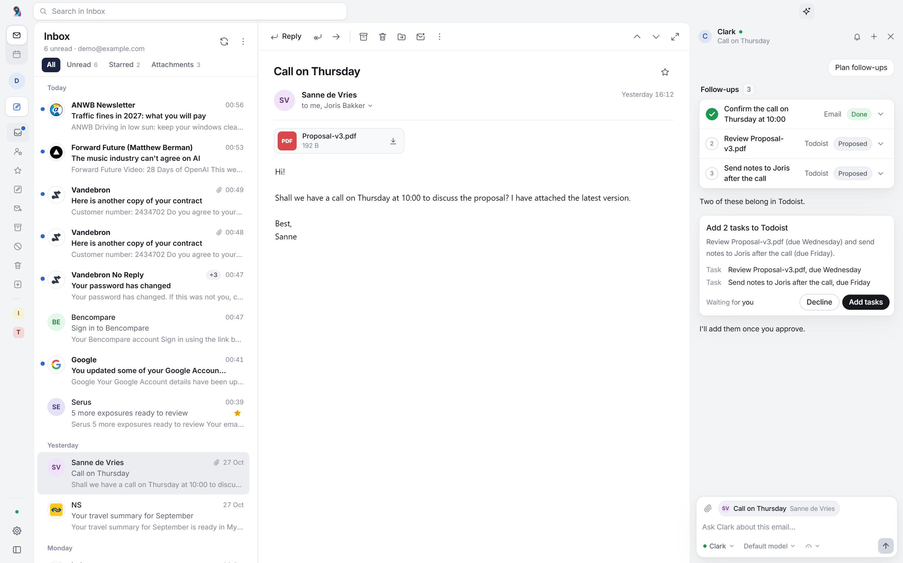
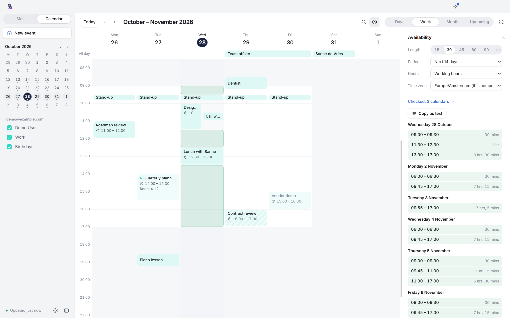

# Rukoo Mail

Rukoo Mail is an open-source email client for Windows and Linux. A macOS build and an Android app are experimental. Mail, calendar and agent chat share one window. You connect your own mail accounts and your own agent: Hermes Agent, Claude Code, Codex or OpenClaw.

The latest release is [2.1.2](https://github.com/MajesteitBart/rukoo/releases/tag/v2.1.2). It answers calendar invitations from the email, opens .ics files and adds a right-click menu for links, images and text in an email. [2.1.1](https://github.com/MajesteitBart/rukoo/releases/tag/v2.1.1) labeled each email with its category and let a category stay out of Inbox or stay quiet. [2.1.0](https://github.com/MajesteitBart/rukoo/releases/tag/v2.1.0) added a full calendar, an overview of your free time and booking pages on meet.rukoo.io.

## Install

Download Rukoo from [GitHub Releases](https://github.com/MajesteitBart/rukoo/releases/latest).

| Platform | Status | Download |
| --- | --- | --- |
| Windows 10 and 11, x64 | Supported | `Rukoo-Mail-Setup-<version>.exe`, or the portable `.exe` |
| Linux, x64 | Supported | `.deb` for Ubuntu and Debian, AppImage for other distributions |
| macOS 13 or newer | Experimental | DMG or ZIP, `arm64` for Apple Silicon or `x64` for Intel |
| Android 12 or newer | Experimental | `Rukoo-Android-<version>.apk`, built for the Galaxy Z Fold7 |

The builds aren't signed yet, so Windows SmartScreen warns before the first start: choose "More info", then "Run anyway". `SHA256SUMS.txt` in each release has the checksums of the desktop packages, and the release notes give the APK's.

No mail account at hand? Pick the demo account during setup. It has sample mail and a sample calendar.

Few people have used Rukoo on a real Mac so far, and Mac builds are only notarized when the release notes say so. If you try it, please tell us what works and what breaks in [issue #74](https://github.com/MajesteitBart/rukoo/issues/74). [Platforms](docs/platforms.md) covers the tray, email links and profile folders on each system.

## What it does

### Mail

- Gmail and Google Workspace accounts use Sign in with Google. Yahoo, Outlook, Exchange and other providers connect over IMAP and SMTP.
- One inbox for all your accounts, or one account at a time. Search covers the folder, the account or every account.
- Inbox categories split the inbox like Gmail's tabs, on every account: Needs you, To read, Money, Updates, Promotions and your own. Nothing changes on the mail server. With your own TypeSafe API key, Jev sorts the mail that Rukoo's rules aren't sure about.
- Three or more messages from one sender fold into one row. Newsletters get an Unsubscribe button.
- You write in the reading pane or in a separate window. Drafts save to the server while you type, and each account can have its own formatted signature.
- You can undo a delete, archive or move with `Ctrl+Z`. The keyboard shortcuts can follow Gmail, Outlook, Apple Mail or Thunderbird, and on a touch screen you choose what a swipe does.

More in [Mail](docs/mail.md) and [Inbox categories](docs/categories.md).

### Calendar and booking

- The calendar (`Ctrl+2`) shows your Google calendars and the CalDAV calendars of IMAP accounts together, by month, week, day or what's coming.
- Drag on the grid to create an event, and drag events to move or resize them. Events can have guests, repeats, reminders and their own time zone. Google calendars add Meet links.
- The availability panel (`A`) lists your open time across your calendars. The composer's calendar button inserts the same list into a message.
- A booking page such as `https://meet.rukoo.io/sanne` lets people, and their AI assistants, pick a time with you. Each booking lands in your calendar, which sends the invitation, and can get its own Zoom, Microsoft Teams or Jitsi Meet link.

More in [Calendar](docs/calendar.md) and [Booking page](docs/booking.md).

### Agents

- The chat panel (`Ctrl+J`) sits next to the email. It works with Hermes Agent (such as Clark), Claude Code, Codex and OpenClaw.
- Quick actions draft a reply, brief you on the sender, plan follow-ups or summarize. You can edit them and add your own.
- Agents read your mail and calendar and write drafts through Rukoo's own MCP server. Rukoo never sends mail for them. Anything other people will see, and every event an agent adds, waits for your approval, unless you give a chat a looser [permission level](docs/agents.md#permission-level).
- `/name` in the chat starts a skill in the Agent Skills format, from Rukoo's own set or from your skills folder.

More in [Agents](docs/agents.md).

### Across devices

- A Rukoo account keeps your categories, your corrections and your booking page the same on every device. It's end-to-end encrypted: the key comes from your password and never reaches the server. The default server at rukoo.io takes new accounts with an invite code for now. See [Rukoo account](docs/account.md).
- Rukoo for Android does mail and agent chat on the phone. Paired with your computer, it runs its Claude Code and Codex chats on that computer. See [Rukoo for Android](docs/android.md).

The interface is in English and Dutch. You choose during setup or in Settings → General → Language.

Every six hours Rukoo asks GitHub whether a newer release exists. That request shows GitHub your IP address. The Windows installer and the Linux AppImage download the new version, check it against the SHA-512 hash in the release's `latest.yml` and install it when you quit Rukoo; the Restart to update button does that right away. The portable Windows app, the `.deb` package and the Mac app show an Update button that opens the release page. Settings → About turns the check off and picks the update channel: Stable gets releases, Nightly also gets the daily builds of `main` (pre-releases on GitHub). Switching from Nightly back to Stable keeps the installed build until the next release.

## Screenshots

Clark planned the follow-ups for an email and waits for approval before it adds tasks to Todoist.



The week view, with the availability panel listing open time for the next 14 days.



More screens are in [docs/screenshots](docs/screenshots), in light and dark mode, and in the feature docs.

## Limits

- Google sign-in needs your own OAuth client from Google Cloud. Neither this repository nor the release builds include one. [Google sign-in](docs/mail.md#google-sign-in) explains how to add it.
- Most Outlook.com and many Microsoft 365 mailboxes need OAuth, which Rukoo doesn't support yet. Microsoft calendars aren't supported either ([#17](https://github.com/MajesteitBart/rukoo/issues/17)).
- Rukoo keeps the newest 300 inbox messages and 100 per other folder on your computer. Older mail stays on the server.
- Bookings reach your calendar only while Rukoo runs on the computer that handles your booking page. Until then the server holds them.
- Rukoo for Android has no calendar or push mail yet.
- A message with a large attachment downloads in full before its text shows ([#56](https://github.com/MajesteitBart/rukoo/issues/56)).

## Development

Rukoo needs Node.js 22 or newer.

```bash
npm install
npm start          # launch the app
npm test           # unit tests
npm run test:e2e   # Playwright tests that drive the Electron app
```

The main process in `src/main/` handles accounts, mail, the calendar, local storage and agent connections. The renderer in `src/renderer/` is plain HTML, CSS and ES modules, without a framework or bundler, and reaches the main process only through the IPC bridge in `preload.js`. `server/` holds the Cloudflare Worker behind the Rukoo account and booking pages, and `android/` holds the Android app.

[Developing Rukoo](docs/development.md) has the code map, builds and the release steps. [The translation guide](docs/translations.md) explains how to add a language or find a label.

## License

Rukoo is released under the [MIT License](LICENSE).

Some parts come from other projects and keep their own licenses. The chat panel's components are ported from [Beautiful UI](https://beautifului.dev) by Shane Levine, under the MIT License; the notice is at the top of `bui.js` and `agent.css`. The interface font is [Inter](https://rsms.me/inter/) by Rasmus Andersson, under the SIL Open Font License (`src/renderer/assets/fonts/Inter-LICENSE.txt`).
