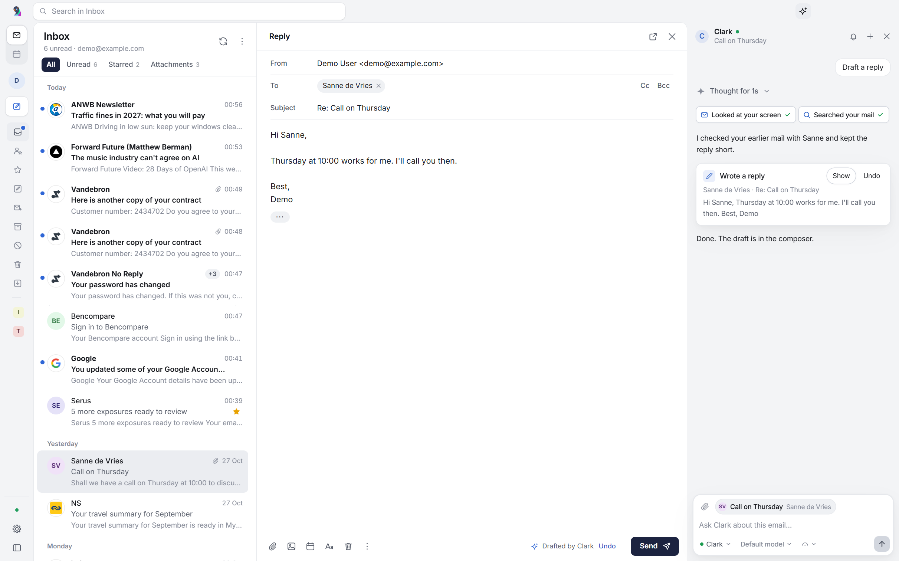
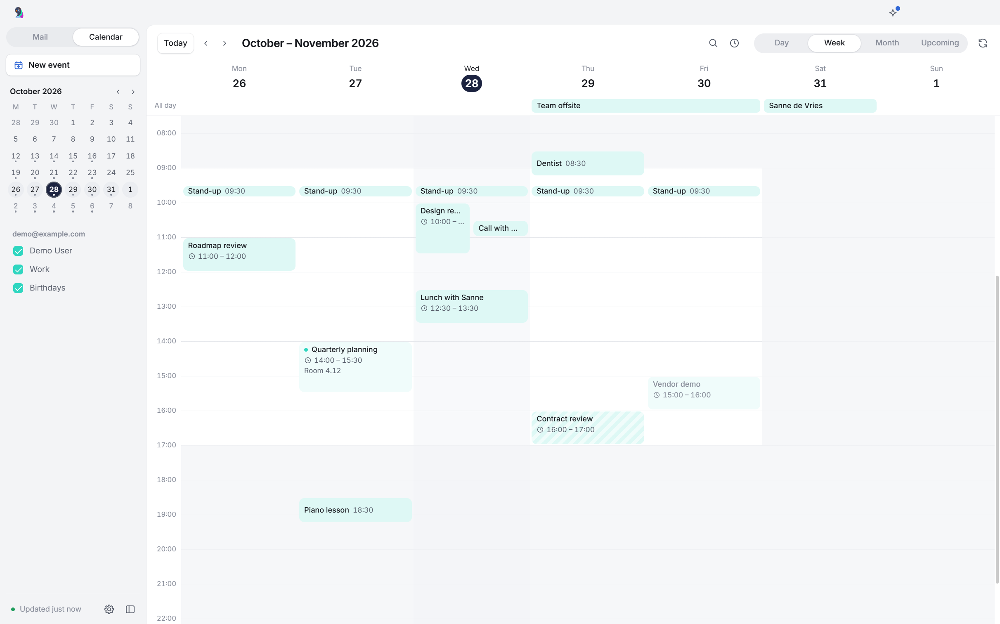
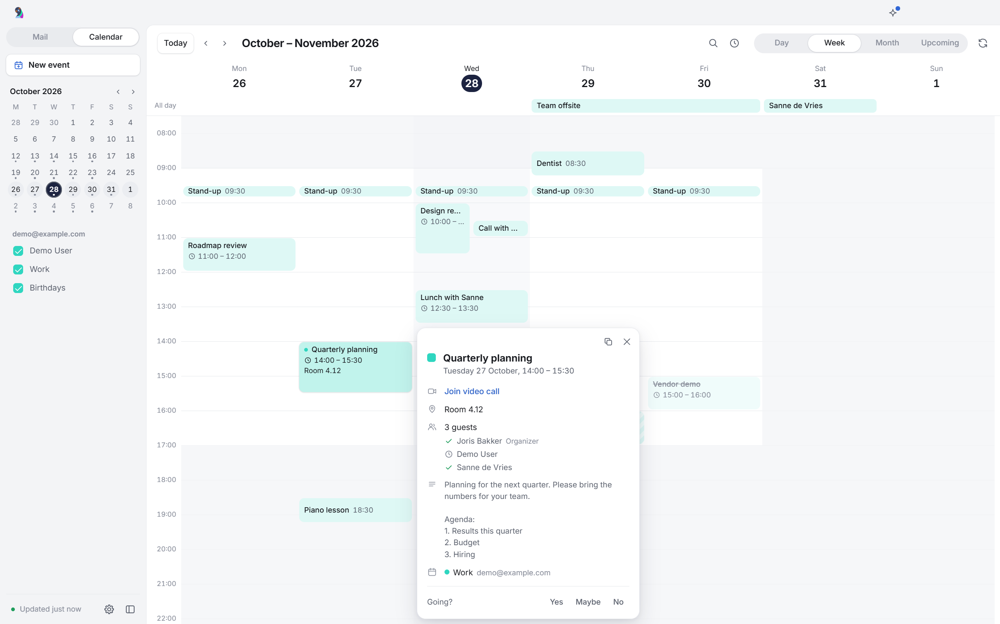

# Rukoo Mail

Rukoo Mail is an email client for Windows and Linux, with experimental macOS support, built with Electron. It has three panes: folders on the left, a message list you can resize, and a reading pane where you also write. A switch at the top of the sidebar replaces the list and the reader with a calendar, which shows the calendars of your Google accounts and of IMAP accounts with a CalDAV server together. A booking page lets other people, and their AI assistants, pick a time with you. The interface uses Inter and supports English (the default) and Dutch. Choose a language during setup or in Settings → General → Language; the preference applies to every window and is saved.

A chat panel next to the email lets you hand it to an agent: a Hermes Agent such as Clark, Claude Code, Codex or an OpenClaw agent. The agent drafts the reply in the composer, plans follow-ups, looks things up in its own tools and asks you before it acts. See [Agents](docs/agents.md).

Translation labels have descriptive keys and screen context in the [English source catalog](src/i18n/en.js). See [the translation guide](docs/translations.md) for adding a language or finding a label.


## Platforms

| Platform | Status | Packages |
| --- | --- | --- |
| Windows 10 and 11, x64 | Supported | Installer and portable `.exe` |
| Linux, x64 | Supported | `.deb` for Ubuntu and Debian, AppImage for other distributions. See [Linux](#linux). |
| macOS 13 or newer, Apple Silicon and Intel | Experimental | DMG and ZIP, notarized only when the release notes say so. See [macOS](#macos-experimental). |
| Android 12 or newer, built for the Galaxy Z Fold7 | Experimental | APK in releases from v1.5.0, or built from `android/`. See [Rukoo for Android](docs/android.md). |

Releases up to v1.2.0 contain only Windows packages; later releases add Linux and macOS packages, and from v1.5.0 the Android APK. You can also [run Rukoo from source](#run-it) on all three.

**Testing on a Mac?** macOS support passes the automated tests on Apple Silicon and Intel, but few people have used it on a real Mac yet. Please share what works and what doesn't in [issue #74](https://github.com/MajesteitBart/rukoo/issues/74).

## What works

- "Sign in with Google" for Gmail and Google Workspace. You sign in in your browser (OAuth 2.0 with PKCE), after which IMAP and SMTP use XOAUTH2. No app password needed.
- IMAP accounts for Yahoo, Outlook, Exchange, Office365 and any other provider, with preset servers per provider and manual IMAP/SMTP settings.
- A demo account with English sample mail, so you can try the app without credentials.
- An account switcher at the top of the sidebar, with a unified inbox across accounts ("All accounts"). It lists each account by its display name, with the address underneath. In the unified inbox each message carries a short account label. A new message started there, from the tray or from an email link uses the default account, which Settings marks with a badge and lets you change beside each account. A new message from another account offers Use as default account beside From.
- A sidebar with Inbox, VIPs, Starred, Drafts, Sent, Archive, Spam, Trash, Saved emails and your own folders. It collapses to an icon rail, and does so by itself in narrow windows.
- Search in the title bar, in the current folder, the current account or all accounts. Quick filters above the list: Unread, Starred and Attachments.
- The list shows sender logos for companies and initials for people, previews without "view in your browser" lines or greetings, and folds a run of three or more messages from one sender into a single row.
- The newest message opens when you start the app or switch folders; it stays unread until you open it yourself.
- Ctrl+click and Shift+click select several messages for one action. Right-click opens a menu with shortcuts, and you can drag messages onto a folder.
- Deleting, archiving and moving can be undone from the notice that follows, or with `Ctrl+Z`.
- The reading pane has its actions in a toolbar at the top; the subject moves into it when you scroll. The header reads "to me, Joris Bakker" and opens the full details on request. Newsletters get an "Unsubscribe" button that uses their List-Unsubscribe link, one-click where the sender supports it. Attachments show as compact cards with image thumbnails and "Save all". The mail keeps a readable width, and the grey canvas of newsletters is cleared. Mail wider than the pane shrinks to no less than 80% and scrolls sideways for the rest. With "Fit content to window" off, it scrolls sideways at full size.
- HTML mail renders in a sandboxed frame with scripts stripped. In dark mode HTML mail is recoloured; you can switch that off.
- New mail, replies and forwards open in the reading pane, with Send at the bottom right. A button moves the message into a window of its own, which remembers its size and position. Formatting appears above selected text, or as a row you switch on. Earlier mail in a reply waits behind a "···" pill and can be left out. There is recipient autocomplete, Cc and Bcc, attachments by picker or drag and drop, links and inline images.
- Signatures can be plain text or formatted: paste one from another mail app or a web page, or write it in Settings with bold, links, colors and images, or edit its HTML. There is a general signature and one per account, each with a preview. Pasted HTML is cleaned: scripts, forms, frames, event handlers and unsafe links are removed. Images in a signature, or inserted in a message, are sent as inline attachments, so mail apps that drop embedded image data still show them; images from the web stay links to the web. The plain-text part of the mail carries the signature as text.
- Drafts save to the server's Drafts folder automatically while you write. Opening another message keeps what you wrote as a draft; closing with unsaved changes asks whether to keep them.
- The app remembers the list width, the sidebar state and where the windows were. The list has a standard and a compact density.
- Swipe actions on touch screens: right marks read or unread, left deletes.
- Sorting, mark all as read, empty Trash, and new folders from the "+" next to Folders.
- A calendar next to the mail (`Ctrl+2`). It shows the calendars of every Google account, and of every IMAP account with a CalDAV server in its Server settings, together, as a month, a week, a day or a list of what's coming. A month shows a few events per day and "+N more" for the rest. A small month at the top of the sidebar marks today and the days with events, and `G` or a click on the title goes to any date. Each calendar can be switched on and off, and has the color its provider gave it or one of 12 from its menu in the sidebar. Search (`/`) finds events by title, place, description and guests. The demo account has a sample calendar.
- Drag on the week or day grid to make an event, drag an event to another time or day, or drag its bottom edge to change its length. In the month view you drag across days for an all-day event, or drag an event to another day. Undo, or `Ctrl+Z`, puts a moved or resized event back. A click on an empty spot, or a drag, opens a small popover with the title, the calendar, guests, Google Meet and a line that names what the time overlaps. Enter saves it, and More options opens the full dialog. The dialog adds the place and the description, and under More the repeat, reminders, the event's time zone, Show as (busy or free) and visibility. Picking another calendar there moves the event to another calendar of the same account. Duplicate on an event's card starts a new event with the same details.
- You add and remove guests, with suggestions from your contacts, and mark them optional, on Google calendars and on CalDAV calendars whose server sends the invitations. Guests only get an email from Google when you say so. You answer invitations with Yes, Maybe or No. Google calendars that allow it get a Google Meet switch, and the event's card a button to join the call.
- Events repeat every day, every weekday, weekly, monthly on a date or on the first to fourth or last weekday, yearly, or by your own rule with an interval, weekdays and an end. Changing, moving or deleting one occurrence asks whether that goes for this event, this and following events, or all events. A rule the dialog can't edit shows as "Custom rule, kept" and stays as it is.
- An event takes up to five reminders, from the start to a week before, and for all-day events at 09:00 on the day or up to a week before. Rukoo shows them as desktop notifications, also while its window is open, with several at once in one notification; a click opens the event. Settings → Calendar turns them off and sets a default reminder for timed events whose calendar sets none, such as CalDAV events without an alarm.
- Settings → Calendar also has the first day of the week, weekends, working days and hours (the grid dims the time outside them) and the default event length, and per calendar its color and whether it counts toward your availability.
- An availability panel (`A`) lists your open time across the calendars that count toward availability, for a length of 15 to 90 minutes, this week, next week or the next 14 days, within your working hours, your booking page's hours or any time, in your time zone or another. While it is open the grid shows the same open time. It names the accounts it couldn't read instead of treating them as free. From the panel you copy the times as text, copy your booking link or block a day on your booking page.
- A booking page, such as `https://rukoo.io/sanne`, where people and their AI assistants pick a time with you. It runs on your Rukoo account, Rukoo puts each booking in your calendar, and your calendar sends the invitation. Booking requests that wait for your approval show on the calendar grid as dashed blocks, with Accept and Decline on their card, and the Calendar switch counts them. The composer's calendar button inserts your link or a list of your free times, and a line under your signature can carry the link. See [Booking page](docs/booking.md).
- CalDAV calendars for IMAP accounts whose provider offers CalDAV. Enter the CalDAV address with the manual server settings when you add the account, or later in its Server settings; a host name such as `caldav.example.com` is enough when the server supports `/.well-known/caldav`. Rukoo signs in with the account's username and password.
- A chat panel (`Ctrl+J`) for Hermes Agent, Claude Code, Codex and OpenClaw. Quick actions draft a reply, brief you on the sender, plan follow-ups, tell the team, update other systems, unsubscribe and summarize. You can hide, reorder and edit them, and add your own, in Settings → Agents → Shortcuts. Agents read mail and write drafts through Rukoo's own MCP server and never send mail; anything other people will see waits for your approval. Each chat can pick its own model and effort under the input. You can attach files and other emails to a message with the paperclip, by dragging them onto the panel, by pasting, or with "Add to chat" in an email's menu. Works the same for every provider. See [Agents](docs/agents.md).
- Inbox categories split the inbox into tabs, like Gmail's, for every account: Needs you, To read, Money, Updates and Promotions to start with, which you can rename, reorder and add to. Nothing moves on the mail server. Rukoo sorts by the mail's headers, the sender and Gmail's own tabs, and optionally with Jev, TypeSafe's decision model, using your own API key. Move an email to another category, and choose to do the same for its sender's later mail. See [Inbox categories](docs/categories.md).
- A Rukoo account keeps Rukoo's own data, such as inbox categories and your corrections, the same on your devices. It is end-to-end encrypted: the key comes from your password and never reaches the server. Settings → Rukoo account shows who runs the server, where it keeps data and what it can see, and exports or deletes everything. Rukoo uses the server at `https://rukoo.io`, run by its maintainer; the account API, the booking pages and Rukoo's website share that address. Devices that use the old address, `https://rukoo-account.bvdm.ai`, keep working there. The server is in `server/`, ready to deploy to your own Cloudflare account. See [Rukoo account](docs/account.md).
- Rukoo on an Android phone can pair with this computer in Settings → Agents → Phone. Pairing shows an address and a code for the phone, and can send the phone your accounts and agent settings once. The phone then runs its Claude Code and Codex chats on this computer over Tailscale, with Rukoo's tools acting on the phone's mail, and Clark's bridge finds Rukoo on the phone as well. See [Rukoo on your phone](docs/agents.md#rukoo-on-your-phone) and [Rukoo for Android](docs/android.md).
- Skills in the Agent Skills format: Rukoo's own from `skills/`, and yours from `%APPDATA%\Rukoo Mail\skills`. Every agent gets them through Rukoo's MCP server, and `/name` in the chat input starts one. `$` offers the skills of the agent itself: the ones on your Hermes server, or the ones you installed for Claude Code or Codex. OpenClaw's gateway doesn't list its skills, so OpenClaw has none after `$`; it still uses them on its own. See [Skills](docs/agents.md#skills).
- Zoom from 80% to 200% with `Ctrl+Plus`, `Ctrl+Minus` or Ctrl and the mouse wheel. The main window and the compose windows share one level, and the app remembers it.
- Settings: language, theme, zoom, list density, swipe actions, fit content to the window, sender logos, notifications, taskbar badge, sync interval, close and minimize to the tray, the app for email links, signature (none by default, plain text or formatted) and the booking link under it, spam addresses, VIPs and folder visibility. Settings → Calendar and Settings → Booking page sit in a group of their own.
- `mailto:` links from your browser and other apps. The installer offers Rukoo Mail to Windows as an email app, and the installed app does so again when it starts if needed; the portable build does so when you click Use Rukoo Mail under Settings → General → Email links. That button opens the Windows Default apps page, where you pick Rukoo Mail, because Windows doesn't let an app make itself the default. The row shows which app opens the links now. A link opens a filled-in compose window with its To, Cc, Bcc, subject and text; Rukoo never attaches files a link names, and you send the message yourself. What the link filled in counts as unsaved: closing the window asks whether to keep it, and it saves to Drafts after a few seconds. A link with only an address closes without asking. While Rukoo runs, only the compose window comes up, also when the main window is in the tray. Before you add an account, the compose window says so and becomes the message once you have one. A link in a message opens the same way. The registration is for your Windows user only. Uninstalling removes it when it belongs to that installation; a portable copy keeps its own until you pick another app, and moving the portable `.exe` updates it at the next start.
- Desktop notifications for new mail. Windows also shows a count badge on the taskbar icon, and macOS on the Dock icon.
- On Windows, closing the window keeps Rukoo running in the tray, so mail keeps syncing and new mail still notifies you. Clicking the tray icon or a notification brings the window back where it was, with a half-written reply still in it. The icon's menu opens Rukoo, starts a new message, syncs or quits. Its tooltip counts unread mail, and a dot on the icon repeats the taskbar badge. Minimizing can hide the window in the tray as well. Turn both off in Settings → General to have closing quit Rukoo again. Windows 11 first puts the icon among the hidden icons, behind the arrow on the taskbar; drag it onto the taskbar to keep it in view.

Keyboard in the main window: `Ctrl+N` new mail, `Ctrl+R` reply, `Ctrl+Shift+R` reply all, `Ctrl+F` forward, `Ctrl+E` or `/` search, `↑`/`↓` previous and next, `Shift+↑`/`Shift+↓` extend the selection, `Ctrl+A` select all, `Ctrl+Q` mark read, `Ctrl+U` mark unread, `Ctrl+Shift+V` move, `Delete` delete, `Ctrl+Z` undo, `Ctrl+P` print, `F5` sync, `Esc` clear the selection or search. While writing: `Ctrl+Enter` send, `Ctrl+S` save the draft, `Ctrl+K` insert a link, `Esc` close. In every window, also with the focus inside an email: `Ctrl+Plus` (or `Ctrl+=`) zoom in, `Ctrl+Minus` zoom out, `Ctrl+0` back to 100%. The numpad keys work too.

Keyboard in the calendar: `Ctrl+1` back to the mail, `T` today, `←`/`→` (or `K`/`J`) the previous and next month, week or day, `M` month, `W` week, `D` day, `U` upcoming, `G` go to date, `/` search, `A` availability, `N`, `C` or `Ctrl+N` new event, `Ctrl+Z` undo the last move or resize, `F5` sync, `Esc` cancel a drag or close a popover, the search or the panel. With an event's card open: `E` edit, `Delete` delete (or cancel a booking), `Esc` close. In the small month in the sidebar, the arrow keys, `Page Up`/`Page Down` and `Home`/`End` move between days, and `Enter` opens one.

## Screenshots

These use the English interface and English demo emails. The same screens in dark mode are in [docs/screenshots/dark](docs/screenshots/dark). The inbox screenshot under the introduction shows the newest message opened by itself; "+3" marks three more messages from the same sender folded into one row. To take them again, run `npm run screenshots`. The capture script always uses English with a fresh demo profile.

Scrolled down, the subject moves into the toolbar.


Personal mail reads "to me, Joris Bakker", with the attachment as a card.


The full sender and recipient details, on request.


Four messages from Vandebron No Reply, unfolded from one row.


A reply in the reading pane, with the earlier mail behind "···".


Formatting appears above selected text.


The earlier mail, with "Exclude from message" to leave it out.


The first run.


Settings.


Clark drafted a reply to Sanne into the composer; the chat shows what it looked at.



Planned follow-ups, and an approval card before anything goes to Todoist.


The calendar, with the demo account's week.



An invitation that waits for an answer.



## Limits

Google sign-in needs an OAuth client of type "Desktop app" from Google Cloud. The client is not in this repository. The app looks for it in this order:

- the `SEM_GOOGLE_CLIENT_ID` and `SEM_GOOGLE_CLIENT_SECRET` environment variables;
- `%APPDATA%\Rukoo Mail\google-oauth.json`, as `{"client_id": ..., "client_secret": ...}` or Google's own download format, which "Import Google OAuth client" on the setup screen writes for you.

While the client's consent screen is unverified, Google shows a warning before you can continue. A Workspace admin may also have to trust the app for the `https://mail.google.com/` scope.

The calendar asks Google for two more scopes, `calendar.calendarlist.readonly` and `calendar.events`. They only work once the Google Calendar API is turned on in the Cloud project of your OAuth client: APIs & Services → Library → Google Calendar API → Enable. Until then the calendar shows Google's error with a button to that page. Google's consent screen lets you leave the calendar out; mail still works, and the calendar offers "Connect calendar" for that account. Accounts added before the calendar existed sign in once more through the same button, and their mail access stays as it was. Guests, repeats, reminders and Google Meet go through `calendar.events`; the calendar list gives each calendar's color, its default reminders and whether it allows Meet. Google can take a few seconds to make a new Meet link, so Rukoo asks for it again after 2, 5 and 15 seconds. Rukoo doesn't show whether guests are free when you invite them: that needs Google's `calendar.freebusy` scope, and asking for one more scope would send every Google account through sign-in again.

The calendar shows times in the PC's time zone. An event keeps its own time zone, which you can change under More in its dialog. Rukoo keeps the weeks you looked at in `%APPDATA%\Rukoo Mail\data\calendar` and fetches them again at every sync. Answering an invitation lets Google tell the organizer. A change or deletion only applies to the version of the event you saw: when the event changed in Google Calendar in the meantime, Rukoo shows the latest version and keeps your edits on top of it, so the next Save doesn't overwrite the other change. Events Google made itself, such as a flight Gmail found or a contact's birthday, can be deleted but not edited, because Google doesn't take a new title or time for them. Search reaches a year back and a year ahead in Google calendars, and from 30 days back to 180 days ahead in the others. Reminders show for the calendars you switched on, while Rukoo runs; `data\reminders.json` remembers which ones showed, so a restart doesn't repeat them.

A CalDAV calendar uses the username and password of the account's mail servers, and only over https, except for a server on the same PC. Rukoo sends them only to the host you entered; when the server sends Rukoo to another host, the calendar names that host so you can enter it yourself if you trust it. Rukoo checks the address when you add the account or save Server settings, saves nothing until it works, and remembers where the server keeps your calendars. Calendars get the color and time zone the server gives them. Rukoo reads each event whole and works out the occurrences of a recurring event itself, in the event's own time zone. New timed events carry their time zone's name (TZID) and its definition (VTIMEZONE), so a repeat added later keeps its clock time across daylight saving changes. A single event in the hour the clocks go back is written in UTC instead, because a zone name can't say which of the two times it means. Changing or deleting one occurrence writes an exception into the series, and every change only applies to the version you saw, as with Google. Deleting a whole series also only applies to the version you saw. Moving an event to another calendar uses the server's WebDAV MOVE; where the server doesn't offer it, only events without guests can move. A series that another app changed from one occurrence onwards (RANGE=THISANDFUTURE) shows that change but can't be changed from Rukoo. Task lists on the same server are left out.

Guests on CalDAV need a server that sends the invitations itself, which it says with `calendar-auto-schedule`. Where it does, you add, remove and change guests, the server emails them about every change without Rukoo asking first, and you answer invitations with Yes, Maybe or No. Elsewhere you can't add guests, and events with guests other than you, or with a room or resource booked, can't be changed or deleted from Rukoo, because the server might email the guests or change the booking without asking; the card shows your answer without buttons. When a server gets this wrong, set "Invitations to guests" in the account's Server settings to "The server sends them" or "The server doesn't send them"; Automatic follows the server.

What the calendar doesn't do yet:

- Calendars of Microsoft accounts ([#17](https://github.com/MajesteitBart/rukoo/issues/17)).
- Guests on a CalDAV calendar whose server doesn't send invitations.
- Invitations in the mail itself: an invitation shows as an ordinary email, without buttons to answer it. Answer it on the event in the calendar.
- Bookings without Rukoo running: a booking reaches your calendar, and the guest the invitation, when Rukoo runs on the computer that handles your booking page. Until then the server holds it.

Other providers use IMAP and SMTP with a password. Yahoo, and Gmail without Google sign-in, only accept an app password; their setup form says so above the password field and links to the page where you create one. Microsoft has switched off password sign-in for most Outlook.com and many Microsoft 365 mailboxes, and those need OAuth, which this app does not implement yet. Exchange works when the server offers IMAP and SMTP; Exchange ActiveSync is not supported.

Each folder keeps the newest 300 messages (inbox) or 100 (other folders) locally. Older mail stays on the server, but the inbox's unread count still includes it: each sync asks the server how many of the older inbox messages are unread. The sidebar's Inbox count, the account menu, the tray tooltip and a taskbar or Dock badge set to count unread mail use that total. The list itself only holds those 300 messages, so the Unread filter counts them, and the list's header shows both numbers, for example "7 unread, 434 more in older mail". Older mail from senders you marked as spam counts too, because Rukoo doesn't have its headers, and Mark all as read only reaches the 300 messages Rukoo keeps. The list holds headers and a short preview; a message's full content is downloaded when you open it. After each sync Rukoo also downloads the newest 30 inbox messages of up to 1 MB each, so they open without waiting for the server. Those downloads don't mark anything read, and a downloaded message is deleted again once it drops out of the folders Rukoo keeps. A message that isn't downloaded yet comes over a second connection to the server, so opening it doesn't wait for a sync that is running. A sync only asks for the flags of messages Rukoo already has.

Sender logos are the icons companies publish on their own websites. The app fetches one per sender domain, caches it in `%APPDATA%\Rukoo Mail\logos` and tries a missing one again after a week. That request tells the company's web server that someone opened mail from it, much like loading images in the mail itself. Mail from free-mail providers such as Gmail or Ziggo never triggers a request. You can switch logos off in the settings.

Passwords and Google refresh tokens use Electron's `safeStorage`: Windows DPAPI on Windows, Keychain on macOS, and GNOME Keyring or KWallet on Linux. macOS and Linux refuse to save new credentials when secure system storage is unavailable; demo mail still works. Account data and the message cache live in `%APPDATA%\Rukoo Mail\data` on Windows; [Linux](#linux) and [macOS](#macos-experimental) use their own profile folders. Earlier builds, named "E-mail", used `%APPDATA%\E-mail`; the app moves that folder on first launch.

## Run it

Requires Node.js 22 or newer and a graphical desktop.

```bash
npm install
npm start
```

`npm start` goes through `scripts/start.js`, which clears `ELECTRON_RUN_AS_NODE`. Terminals that run on Electron (VS Code, T3 Code) export that variable, and it makes `electron.exe` behave like plain Node.

Build packages for the current platform in `dist/` (Windows installer and portable executable, macOS DMG and ZIP, or Linux x64 AppImage and `.deb`):

```bash
npm run dist
```

## macOS (experimental)

macOS support is experimental. Native CI runs the tests on Apple Silicon and Intel, but few people have used Rukoo on a real Mac yet, and builds are only notarized when the release notes say so. If you try it, please report your findings in [issue #74](https://github.com/MajesteitBart/rukoo/issues/74): what works, what breaks, your Mac model and your macOS version.

macOS 13 or newer is required by the bundled Electron version. Choose `arm64` for Apple Silicon or `x64` for Intel. Open the DMG, drag Rukoo Mail to Applications and launch it there; ZIP builds contain the same app bundle. To build both architectures on a Mac:

```bash
npm run dist:mac
```

The red close button hides the main window while mail keeps syncing. Click Rukoo in the Dock to return to the same reader or draft. **Rukoo Mail → Quit Rukoo Mail** or **⌘Q** quits, asking about unsaved drafts. A separate compose window still asks about its unsaved draft when closed. Tray behavior is off by default; unread counts can appear on the Dock icon.

Use Command instead of Ctrl for mail, compose, calendar and zoom shortcuts. Mark as read uses **⌘ShiftU**, mark as unread uses **⌘U**, and **⌘Q** remains Quit. The native Edit menu supports copy, paste, undo and selection, and shortcuts shown in the interface use ⌘. Zoom and traffic-light spacing apply to both main and compose windows.

Choose **Settings → General → Email links → Use Rukoo Mail** after installing the app. This works only for a copy in Applications or `~/Applications`. When Rukoo runs from the DMG or from Downloads, Settings asks you to move it there first, so email links never point at a copy that disappears later. macOS may request confirmation. If needed, choose Rukoo Mail as the default email reader in **Apple Mail → Settings → General**. Links delivered while Rukoo starts wait until its windows are ready.

macOS 15 and later may ask whether Rukoo Mail can find devices on your local network, sometimes right after launch. Rukoo doesn't need that access with default settings, so denying it is safe. It may matter for a mail or calendar server on your own network, and for remote agent access, which connects Rukoo with an agent or a paired phone on another device over Tailscale. If one of those stops working after you denied it, turn Rukoo Mail on under **System Settings → Privacy & Security → Local Network**.

The profile is `~/Library/Application Support/Rukoo Mail`; `data`, `logos`, `skills` and `google-oauth.json` live under that directory. `SEM_DATA_DIR` selects an isolated test profile. Credentials use Keychain; unlock the login keychain if Rukoo cannot save them. Finder-launched agents also search `~/.local/bin`, `/opt/homebrew/bin` and `/usr/local/bin`.

CI creates ad-hoc signed development packages. These are **not Developer ID signed or notarized**, and Gatekeeper may block downloaded builds. Signed public releases require the maintainer's Apple credentials; this repository does not contain them. The release workflow's `sign_macos` option enables Developer ID signing and notarization, requires all configured credentials, and verifies the resulting signature and stapled ticket. Without that option, the workflow explicitly identifies the Mac builds as ad-hoc signed only. Do not describe those as notarized releases.

For signed releases, configure repository secrets `MAC_CSC_LINK` (the Developer ID Application certificate as a base64 P12), `MAC_CSC_KEY_PASSWORD`, `APPLE_ID`, `APPLE_APP_SPECIFIC_PASSWORD` and `APPLE_TEAM_ID`, then select `sign_macos` when starting the release workflow. Native CI runs Mac-specific Electron workflows on both Intel and Apple Silicon, repeats them against the built app, and uploads screenshots as artifacts. Live provider sign-in, notification delivery, and Developer ID/Keychain continuity across upgrades need verification with a signed release on a user's Mac.

## Linux

Linux builds target x64 desktops. The `.deb` is intended for Ubuntu/Debian systems; the AppImage is a portable option for other distributions.

```bash
# Build either explicitly on Linux:
npm run dist:linux
# Install the generated Debian package:
sudo apt install ./dist/Rukoo-Mail-1.2.0-amd64.deb
# Or run the portable build:
chmod +x dist/Rukoo-Mail-1.2.0-x86_64.AppImage
./dist/Rukoo-Mail-1.2.0-x86_64.AppImage
```

Use the version in your downloaded filename. AppImages need FUSE 2 support; where FUSE is unavailable, `--appimage-extract-and-run` runs without mounting. Run Rukoo as your desktop user. Keep Chromium's sandbox enabled; the Debian package includes Electron's sandbox setup. Some distributions restrict unprivileged user namespaces, so prefer the installed package when a portable build cannot start under the system's sandbox policy.

The Debian package installs a launcher and advertises `mailto:` support. Choose **Settings → General → Email links → Use Rukoo Mail**, or select it in your desktop's default applications. This uses `xdg-mime` from `xdg-utils`. An AppImage alone does not install a desktop entry or register its temporary mount as an email handler.

Close-to-tray and minimize-to-tray start disabled on Linux. Enable them only on a desktop with a visible status tray (GNOME may need an AppIndicator extension). Notifications depend on the desktop notification service; the Windows taskbar count overlay is unavailable on Linux. Theme changes apply to the main and separate compose window controls.

Linux keeps its profile under `$XDG_CONFIG_HOME/Rukoo Mail`, or `~/.config/Rukoo Mail` when unset. The `data`, `logos`, `skills`, and `google-oauth.json` paths described elsewhere in this README are relative to that profile instead of `%APPDATA%\Rukoo Mail`. `SEM_DATA_DIR` overrides the entire profile for isolated tests. Do not copy encrypted credentials between operating systems; sign in again on the new system.

Real accounts and agent keys require an unlocked GNOME Keyring (Secret Service) or KWallet. Install and unlock one in your desktop session if Rukoo reports that credentials cannot be saved. Rukoo does not fall back to Electron's insecure `basic_text` storage on Linux.

For headless Electron tests, provide an X display and a window manager so minimize/restore events work. The CI workflows show the Xvfb and Openbox setup with a 1920×1200 display. CI tests and builds on Ubuntu 22.04, Windows and macOS. The demo suite does not verify real mail synchronization, native tray availability, or live agent authentication on every Linux desktop.

## Releases

Download available Windows, macOS, Linux and Android packages from [GitHub Releases](https://github.com/MajesteitBart/rukoo/releases). Each release includes `SHA256SUMS.txt` for the desktop packages; the notes give the APK's checksum. Windows and Linux builds are unsigned. Mac builds are experimental, and they are ad-hoc signed unless the release notes explicitly confirm Developer ID signing and notarization.

Versions follow [Semantic Versioning](https://semver.org): a patch release fixes things, a minor release adds features, and a major release breaks compatibility of behavior, integrations or stored data. Previews use `-alpha.N`, `-beta.N` or `-rc.N` and publish as prereleases. A release is worth making when a new download gives users something: a feature, a visible fix, a security fix or a dependency change that affects the app. Documentation, tests and tooling wait for the next one.

Releases are started manually after a version tag exists. Pushing a branch or tag does not start a build. Maintainers prepare a release as follows:

1. Run `npm version <version> --no-git-tag-version`, commit the package and lockfile changes, and merge the reviewed PR into `main`. Before merging, run `npm test`, `npm run test:e2e` and `npm run dist`, and start the built app with a demo profile.
2. Write the release as a draft on GitHub. Title it `v<version> - Added …` when it adds features, or `v<version> - Fixed …` when it only fixes things, for example `v1.1.0 - Added CalDAV calendars and Microsoft sign-in`. The notes tell users what changed, with known limitations and migration steps. `gh release create v1.1.0 --draft --title "…" --notes-file notes.md` writes the draft without creating the tag.
3. On the tested `main` commit, create and push an annotated tag, for example `git tag -a v1.1.0 -m "Rukoo Mail 1.1.0"` followed by `git push origin v1.1.0`.
4. Build the Android APK from the tag: in `android/`, run `./gradlew assembleRelease` with `signing.properties` in place, and upload `app/build/outputs/apk/release/app-release.apk` to the draft as `Rukoo-Android-<versionName>.apk`, for example with `gh release upload v1.1.0 Rukoo-Android-0.1.0.apk`. Add its SHA-256 to the notes. The workflow doesn't build the APK because the signing key stays with the maintainer, and Android only installs an update signed with the same key. When `android/` changed since the last release, raise `versionCode` and `versionName` in `android/app/build.gradle.kts` first.
5. Open **Actions → Release desktop packages → Run workflow**, select `main`, and enter `v1.1.0`. Alternatively, run `gh workflow run release.yml --ref main -f tag=v1.1.0`.
6. The workflow checks that the tag matches the package and lockfile, runs unit and Electron tests, builds Windows, macOS and Linux packages and verifies their checksums. It then uploads all eight packages to the draft and publishes it.

Tags such as `v1.1.0-rc.1`, and drafts marked as a pre-release on GitHub, publish as prereleases without becoming the latest stable release. A stable release for an older version line does become the latest, so clear that on GitHub afterwards. The workflow stops when the tag has no draft, when the draft's title doesn't start with the tag, or when the release is already published. Never move or reuse a published tag; ship a new version for corrections. If publication fails, fix the cause and choose **Re-run failed jobs**: the build is kept, and the upload replaces files from the earlier attempt. Release publication uses GitHub Actions' built-in token and needs no personal token or extra secrets.

## Tests

```bash
npm test          # unit tests for the engine and mail parsing, plus a live IMAP test
npm run test:e2e  # Playwright drives the real Electron app; chat tests use scripted agents (SEM_AGENT_FAKE=1)
```

The live IMAP tests create a throwaway mailbox on [Ethereal](https://ethereal.email) and skip themselves when it is unreachable.

## How it is built

| Path | Role |
| --- | --- |
| `src/main/engine.js` | Accounts, local cache, sync, flags, moves, sending, drafts, VIP's and spam |
| `src/main/google.js` | Google sign-in: loopback redirect, PKCE, token refresh |
| `src/main/imap.js` | IMAP via [imapflow](https://github.com/postalsys/imapflow), SMTP via nodemailer |
| `src/main/demo.js` | The demo account: same interface as `imap.js`, backed by a local JSON file |
| `src/main/calendar/` | The calendar: the cache, sync and changes for every account (`index.js`) and the checks on what a window sends (`ipc.js`); Google Calendar (`google.js`), CalDAV servers (`caldav.js`) and the demo account's calendar (`demo.js`); iCalendar objects for CalDAV and the demo (`ics.js`) and the time zone definitions written into them (`vtimezone.js`); clock times in named time zones (`zone.js`); open time (`availability.js`, and `free.js` across your calendars); reminders (`reminders.js`, and `reminder-runner.js`, which shows them) |
| `src/main/booking/` | The booking page on this computer: publishing open times, taking bookings into the calendar and keeping the two in step (`index.js`), the settings and guest checks (`rules.js`), and the key that opens guests' details (`keys.js`). See [Booking page](docs/booking.md) |
| `src/main/main.js` | Main and compose windows, IPC table, notifications, taskbar badge, unsubscribe |
| `src/main/windowstate.js` | Remembers window size and position |
| `src/main/tray.js` | The tray icon, its tooltip and menu; `main.js` decides when there is one |
| `src/main/zoom.js` | Zoom steps and the zoom keys; `main.js` applies the level to every window |
| `src/main/logos.js` | Fetches and caches sender logos |
| `src/main/pdftext.js` | Reads the text of a PDF for agents that can't open one themselves |
| `src/main/pdfread.js`, `pdfchild.js` | Run `pdftext.js` in a process of its own, with a time limit and a memory cap |
| `src/renderer/app.js` | The main window: sidebar, list, reading pane, selection, undo |
| `src/renderer/calendar.js`, `calendar-shared.js`, `calendar-event.js` | The calendar view: the month, week, day and upcoming views, the grid and its drags, the sidebar and the keys (`calendar.js`); the state and date helpers they share (`calendar-shared.js`); the event card, the quick popover and the event dialog (`calendar-event.js`) |
| `src/renderer/calendar-free.js`, `calendar-settings.js`, `booking-settings.js` | The availability panel, Settings → Calendar and Settings → Booking page |
| `src/renderer/composer.js` | The editor, inline or in a window, with autosave, the calendar button and the booking link under the signature |
| `src/renderer/compose.js` | The compose window around the editor |
| `src/main/categories/` | Inbox categories: which category an email is in and storing it in the account (`index.js`), the rules (`rules.js`), the header signals a sync collects (`signals.js`) and Jev (`jev.js`). Settings: `src/renderer/categories-settings.js` |
| `src/main/account/` | The Rukoo account: keys and encryption (`crypto.js`), the server's API (`client.js`), and the records kept here and synced (`index.js`). Its settings pages are `src/renderer/rukoo-account.js` |
| `server/` | The account server, a Cloudflare Worker, and its protocol (`PROTOCOL.md`). In `server/src/`: the routes (`index.js`), a Durable Object per account (`account.js`) and per booking page (`booking.js`), the owner API for booking pages (`owner.js`), the pages people open (`web.js`, `pages.js`, `booking-text.js`), the JSON API (`api.js`), the MCP endpoint (`mcp.js`), what assistants read (`agent-text.js`), open times (`slots.js`) and the sealing of guests' details (`seal.js`) |
| `src/main/agents/` | The chat panel's main side: conversations and approvals (`hub.js`), Rukoo's MCP server and tools (`mcp.js`, `tools.js`), skills (`skills.js`, and the agents' own in `ownskills.js`), files attached to messages (`chatfiles.js`), the Hermes, Claude Code, Codex and OpenClaw adapters, with the HTTP helpers Hermes and OpenClaw share (`http.js`), and pairing and Claude Code and Codex turns for Rukoo on a phone (`phonehost.js`) |
| `skills/` | Rukoo's skills in the Agent Skills format, shipped with the app |
| `src/renderer/agent/` | The chat panel (`panel.js`), its quick actions, and the components ported from Beautiful UI (`bui.js`, `agent.css`) |
| `integrations/hermes/` | The stdio bridge that lets a Hermes agent on another machine reach Rukoo's tools over Tailscale, on computers and Android phones |
| `src/renderer/` | Plain HTML, CSS and ES modules, no framework or bundler |

The renderer runs sandboxed with context isolation. It can only call the methods in the IPC table in `main.js`.

## License

Rukoo is released under the [MIT License](LICENSE).

Some parts come from other projects and keep their own licenses. The chat panel's components are ported from [Beautiful UI](https://beautifului.dev) by Shane Levine, under the MIT License; the notice is at the top of `bui.js` and `agent.css`. The interface font is [Inter](https://rsms.me/inter/) by Rasmus Andersson, under the SIL Open Font License (`src/renderer/assets/fonts/Inter-LICENSE.txt`).
