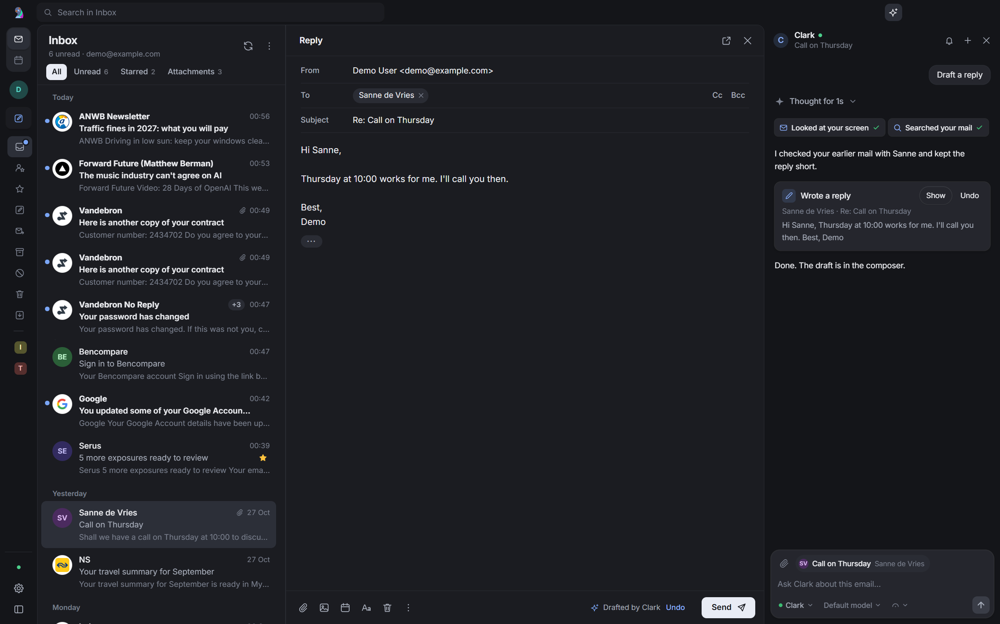

# Agents in Rukoo Mail

Rukoo Mail has a chat panel next to the reading pane. In it you hand an email to an agent: a Hermes Agent such as Clark, Claude Code, Codex or an OpenClaw agent. The agent keeps its own tools, memory and integrations. Rukoo adds the chat and a small set of tools the agent uses to read your mail and change what is on your screen. It writes the reply draft, shows a plan or its sources, and asks you before anything happens.

Open the panel with the sparkle button in the title bar or with `Ctrl+J`. While it is open the folders shrink to a rail, so you see the list, the email and the chat. The rail button brings the folders back, and the reading pane's expand button hides the list too, leaving the email and the chat.



## What you can ask

The panel offers quick actions for the open email. The same actions work as slash commands in the chat input, such as `/reply`. [Skills](#skills) are slash commands too. Type `$` for the [agent's own skills](#the-agents-own-skills). You can also type anything else.

The quick actions are the same with every agent. Settings → Agents → Shortcuts, or the round button after them in a new chat, lists them in their order:

- The switch takes one out of new chats. Its slash command keeps working.
- The arrows move one up or down.
- Click one to change its name or the instructions the agent gets. A quick action of Rukoo's keeps its command; "Restore default" gives it back its own name and instructions.
- "Add a shortcut" makes one of your own: a name, a command, an icon, the instructions, and whether it shows only with an open email or always. The agent gets the instructions with the open email, if there is one.
- "Restore Rukoo's shortcuts" removes your own and your changes.

Rukoo keeps the list in `agents.json`. It holds at most 40 shortcuts, with a name of up to 60 characters and instructions of up to 4,000.

A new chat is about the open email. The email shows as a chip above the input and goes to the agent with your first message. To ask something without it, click the × on the chip. An "Add this email" chip takes its place; click it to put the email back. Once a chat has started it keeps its email, so the chip has no ×. Start a new chat to leave the email out.

### Hand it off

- **Draft a reply** (`/reply`). The agent looks up earlier mail with the sender, its memory and your notes, then writes the reply into the composer in your voice and in the language of the email. You read it and press Send. Rukoo has no tool that sends mail, so an agent can't send one.
- **Unsubscribe** (`/unsubscribe`). Shown for newsletters with a List-Unsubscribe header. The agent unsubscribes you and offers to archive the sender's other mail. Rukoo asks you before either happens.
- **Unsubscribe through the browser** (`/unsubscribe-via-browser`). A skill for unsubscribe pages that want a confirm click or unticked boxes, and for mail without a List-Unsubscribe header. The agent asks you once, then finishes the page in its own browser: it enters only the address the mail went to, unticks every option, confirms and tells you what the page said. It doesn't open the link for mail in the Spam folder, or when the link's domain is neither the sender's nor a known mailing service. This needs an agent with a browser, such as Hermes with its browser tools. Claude Code in Rukoo has none, because Rukoo doesn't turn on `--chrome`, and Codex with "Ask before actions" has no network. Those agents fall back to Rukoo's own unsubscribe, as `/unsubscribe` does.
- **Summarize** (`/summary`). Three bullets, and whether the email needs a reply from you and by when.
- **Ask a sender to delete your data** (`/data-deletion-request`). A skill for marketing mail from a company. The agent drafts a request under the GDPR (the AVG in Dutch), in the language of the email and to the company's privacy contact when it finds one. The request asks the company to erase your personal data (article 17), say where it got your address (article 15(1)(g)), stop direct marketing (article 21), and tell you within one month what it did about the request (article 12(3)). You send it. The agent offers a reminder for when the answer is due. It declines for mail in the Spam folder and for senders it can't identify, because a reply only tells them your address is read.

### Plan the follow-up

- **Plan follow-ups** (`/tasks`). The agent pulls out the actions, with an owner and a due date where it can tell, and shows them as a list in the chat. It proposes adding them to your task system and waits for your approval.
- **Tell the team** (`/team`). Instead of forwarding the email, the agent writes a short message for the right channel, such as Slack, Mattermost or WhatsApp. The message includes the email's Message-ID so people can find it. You approve the message before it goes out.

### Find out more before you reply

- **Brief me** (`/brief`). Who is this, what is your history with them, and what do you need to decide? The agent searches your other mail, its memory, your notes and any other system it can reach, and shows the sources as cards.
- **What needs me today?** (`/triage`). Shown when no email is open. The agent goes through your inboxes in every account and lists what needs you, most urgent first.

### Update other systems

- **Update systems** (`/update`). The agent records the email where it belongs: a CRM contact or deal, your notes, a Linear issue, a Todoist task. It shows the planned updates, proposes each one, and after you approve it does them and adds links to the plan.

Everything the agent creates elsewhere links back to the email by its Message-ID header. That works in any mail client and doesn't depend on Gmail labels or other provider features. Rukoo keeps the chats themselves on your computer, per email.

### Plan a meeting

Ask in your own words, such as "Find half an hour with Sanne next week and put it in my calendar". The agent reads your calendars with `list_events`, looks for open time with `find_free_time` and asks Rukoo to add the event with `create_event`. Rukoo shows the event as a card first, with its title, time, calendar, guests and Google Meet. Create adds it, and the guests get the invitation from that calendar's account. The agent can also hand out your booking page with `get_booking_link`, so the other person picks a time.

## Attach files and other emails

The paperclip before the email chip opens a file dialog. You can also drop files from your file manager on the panel, or paste a screenshot or files you copied. To add emails, drag them from the message list onto the panel, or choose "Add to chat" in an email's menu (⋮ in the reader, or a right-click in the list) or in the menu for checked emails (⋮ in the list toolbar). The menus work from the keyboard and open the panel when it's closed. Each file and email becomes a chip next to the email chip, and its × takes it off again before you send. The chat's own email doesn't need adding, nor does a newer email you continued the chat from, which goes along by itself. An email you add twice counts once.

Your next message takes the chips along, also a quick action or a skill. A message can be just attachments, without text. The chips show above your message in the chat. A message takes up to 10 files and 10 emails.

An email you attached can move after you send it, for example when you archive it. Your message keeps the email's Message-ID and account, so Rukoo finds it again, as it does the chat's own email. The id the agent got still works with `read_message` and `read_attachment`, and a recap after a lost session names the id the email has now.

Rukoo refuses programs and scripts, the same file types it never opens from an email (`.exe`, `.js`, `.ps1`, `.lnk` and the like), and files over 10 MB. A short notice says which file and why. A folder is refused too: add the files in it.

### What each agent gets

| Attached | Hermes Agent and OpenClaw | Claude Code | Codex |
|---|---|---|---|
| A text file | Its text, in the message | Its text, and the path of a local copy | Its text, and the path of a local copy |
| A PDF | Its text, in the message | Its text, and the path of a local copy, which Claude can open with its own Read tool | Its text, and the path of a local copy |
| An image | `read_chat_file` shows it | The image itself, with the message | The image itself, with the message |
| Another file (Word, Excel) | `read_chat_file` hands over the file, which Hermes saves on its own machine | The path of a local copy | The path of a local copy |
| An email | Its Rukoo id, to read with `read_message` | Its Rukoo id | Its Rukoo id |

An OpenClaw gateway can run on another machine, so Rukoo treats it like Hermes and sends it no local paths. It needs [Rukoo's tools](#openclaw) for `read_chat_file` and `read_message`.

Each file has a `file_id` in the message, and `read_chat_file` returns the file with it, the same way `read_attachment` returns a mail attachment: text as text, a PDF as its text with the file itself, an image as an image, anything else as the file. Every agent can call it, so Hermes on another machine gets the files too. Text goes along in the message up to 20,000 characters per file and 60,000 per message; `read_chat_file` returns up to 200,000. An image goes along with the message itself up to 3.75 MB.

Rukoo reads the text of a PDF itself. Codex takes no PDF as input, and Hermes on another machine gets the file without a reader for it, so the text has to come from Rukoo. It reads the text layer only: a scanned PDF has none, and the agent gets the file without text. `read_attachment` gives the text of a PDF in an email the same way.

### Where the files are

Rukoo keeps each chat's files in `agent-workspace/files` inside its profile, in a folder per chat. The profile is `%APPDATA%\Rukoo Mail` on Windows, `${XDG_CONFIG_HOME:-~/.config}/Rukoo Mail` on Linux, and `~/Library/Application Support/Rukoo Mail` on macOS. Settings → About shows the actual profile path. Claude Code and Codex work in `agent-workspace`, so they open a copy without asking. Each copy is named after its `file_id`, so a file name you got from someone else never ends up in a path the agent sees. `conversations.json` keeps each file's name, type, size and id, not its content. The files stay with the chat after a restart, and deleting the chat deletes them. When an agent has lost its session, the recap names the files and emails of earlier messages with their ids, so the new session can read them again.

Until you send, the files wait in Rukoo's memory, for up to two hours. Rukoo reads a file from its own dialog itself. For a dropped or pasted file the panel sends the bytes, never a path for Rukoo to open.

## A reply in a thread you discussed

A chat belongs to one email, so a new reply in that thread has no chat of its own. When you open it, the empty chat offers "Continue the chat about the earlier message", with that chat's agent and when you last used it. Rukoo makes the offer only when the reply's headers link it to the earlier email: In-Reply-To or References name it, or name an email it also answers. A reply to an email you already continued the chat from counts too. A shared subject is not enough, because many unrelated emails are called "Invoice" or "Hello". Both emails must be in the same account. If several chats qualify, Rukoo offers the most recent one, whichever agent it is with.

Continuing opens that chat. The chat stays about its own email. While the newer email is open, a second chip shows it, marked "Newer message". Your next message takes the newer email to the agent, inside `<unsafe_content>` like any email. If you continued the chat from several newer emails before you write, it takes up to three of them, the newest; an older one goes with the message after that. When you open the newer email again later, the panel shows that chat straight away. If you type without picking the offer, Rukoo starts a new chat about the newer email, as before.

## Several chats at once

A chat keeps working when you open another email. The bell in the panel's header lists your chats, the one with the newest message first. Each row names the chat's email, its agent and the time of that message, with what the chat is doing:

- A spinner and "Working…" while the agent answers.
- An orange dot and "Waiting for you" when it waits for your approval.
- A blue dot and "Reply ready" when it answered while you were looking at another chat, or had the panel closed.
- A red dot and "Stopped with an error" when it stopped on an error you haven't seen.
- Otherwise, the start of the last message.

The bell shows how many chats have a reply ready or wait for you. It turns orange while one waits for you, and blue otherwise. With the panel closed, a dot on its button in the title bar says the same. The list updates while it is open.

Pick a chat to open it together with its email. For a chat you continued from a newer email, that's the newest one. If the email has moved since, Rukoo finds it again by its Message-ID. Opening a chat marks its reply as read. A chat you stopped yourself doesn't count as news. Rukoo keeps which replies you haven't read in `conversations.json`, so they're still marked after a restart.

## How each agent connects

| Agent | Connection | Needs |
|---|---|---|
| Hermes Agent (Clark) | Rukoo talks to the Hermes API server over HTTP. Each Rukoo chat is a Hermes session; a turn is a run on Hermes' Runs API. | The API server's address and key. For Rukoo's tools: the bridge in `integrations/hermes` |
| Claude Code | Rukoo starts `claude` (`claude.exe` on Windows) per chat (stream-json) with your own settings, MCP servers, skills and hooks, plus Rukoo's MCP server. | Claude Code installed and signed in |
| Codex | Rukoo starts one `codex app-server` with your own config and adds Rukoo's MCP server to each thread. | Codex CLI installed and signed in |
| OpenClaw | Rukoo talks to your OpenClaw gateway's OpenAI-compatible Chat Completions endpoint over HTTP. Each Rukoo chat is one OpenClaw session. | The gateway's address and token, with the endpoint turned on. For Rukoo's tools: `openclaw mcp set` with the command Rukoo copies |

Set them up in Settings → Agents. Each card shows the agent's status and has a test button. On Linux, Rukoo looks for Claude Code and Codex in `~/.local/bin` and on its `PATH`. If your desktop session does not include the CLI installation directory, set the executable path in the agent card. On macOS, Rukoo also adds `~/.local/bin`, `/opt/homebrew/bin` and `/usr/local/bin` to the agent process PATH, so apps opened from Finder can use Homebrew and npm installations. Rukoo keeps your existing PATH order and does not load shell startup scripts. For installations managed through a shell version manager, launch Rukoo from a terminal with that environment. The agent must already be signed in under your user account.

Claude Code and Codex call Rukoo's MCP server on `127.0.0.1`. A Hermes agent usually runs on another machine, so it reaches Rukoo over Tailscale through a small stdio bridge. Turn on "Let Clark use Rukoo" in the Hermes card, then follow [integrations/hermes/README.md](../integrations/hermes/README.md). "Copy Hermes setup" puts the `config.yaml` block on the clipboard. The block holds no secret and is the same on every device: the bridge finds Rukoo on whichever of your devices has it open. It starts with the command that downloads the bridge from this Rukoo's release. Updating Rukoo doesn't update the bridge. When the two no longer speak the same bridge protocol, the bridge says which one is older instead of reporting a wrong key. Rukoo stays open in the tray after you close its window, unless you turned off "Close to the tray" in Settings → General.

### OpenClaw

Rukoo uses the gateway's [OpenAI-compatible HTTP API](https://docs.openclaw.ai/gateway/openai-http-api), which streams the answer and keeps a session per chat with plain HTTP and the gateway token. The gateway's WebSocket protocol would also show the agent's tool calls, but a third-party app must pair as a device for it, so Rukoo doesn't use it. Rukoo was built against the documentation and source of OpenClaw 2026.10.5.

1. **Turn on the endpoint.** It is off by default. Add this to your OpenClaw config and restart the gateway:
   ```json5
   { gateway: { http: { endpoints: { chatCompletions: { enabled: true } } } } }
   ```
2. **Connect Rukoo.** In Settings → Agents → OpenClaw, check the gateway URL (`http://127.0.0.1:18789` when the gateway runs on this computer, or its Tailscale address when it runs elsewhere) and paste the gateway token, or the password when the gateway uses password auth. The card shows whether the gateway answers and accepts the token. "Test connection" checks it again.
3. **Pick an agent** (optional). Without an agent ID, a chat goes to the gateway's default agent (`openclaw/default`). A chat keeps the agent it started with when you change this later.
4. **Let OpenClaw use Rukoo** (optional). "Copy OpenClaw setup" copies a command such as:
   ```sh
   openclaw mcp set rukoo '{"url":"http://127.0.0.1:47800/mcp","transport":"streamable-http","headers":{"Authorization":"Bearer <token>"}}'
   ```
   Run it where the gateway runs, then restart the gateway so its agents load the tools. `openclaw mcp doctor rukoo --probe` checks the connection. Each chat tells OpenClaw its `conversation_id`, so the tools act on the chat you are in.

   For a gateway on another computer, such as a Mac mini, a home server or a VPS in your tailnet, first turn on "Let OpenClaw use Rukoo from another computer" in the OpenClaw card. Rukoo then also listens on this computer's Tailscale address, and the card shows that address (`http://<Tailscale IP>:47800/mcp`). "Copy OpenClaw setup" now copies a command with that address and a token of its own; the toast says which address went on the clipboard. Run it on the gateway's computer. Windows asks once whether Rukoo may accept connections; allow it for private networks. Rukoo has to be open (it can stay in the tray) for OpenClaw to reach its tools.

How it works and what it can't do:

- Each turn is one `POST /v1/chat/completions` with `stream: true`. `model` names the agent (`openclaw/<agentId>`) and the OpenAI `user` field is `rukoo:<chat id>`, so the gateway keeps one session per chat. Rukoo sends only your new message with its own instructions; the gateway has the earlier turns.
- Stop closes the connection, which cancels the run on the gateway. Quitting Rukoo does the same for every running chat.
- The stream carries OpenClaw's text, not its tool calls or thinking, so the chat shows the answer without tool rows. OpenClaw's own approvals stay in OpenClaw; Rukoo's approval cards work for its own tools.
- The model field in Settings and the chat's model menu set a backend model (`x-openclaw-model`, such as `openai/gpt-5.4`). The gateway lists agents, not models, so the menu offers Default and the model in Settings. It has no effort menu.
- The gateway has no endpoint that lists an agent's skills, so `$` offers none. OpenClaw still uses its skills on its own. Rukoo's skills work as slash commands, and through `read_skill` once OpenClaw has Rukoo's tools.
- Rukoo can't tell when OpenClaw lost a chat's session, so it doesn't send a recap then. An archived session stops the chat with an error until you restore it in OpenClaw's Control UI.
- The gateway token gives full operator access to the gateway. Rukoo keeps it encrypted, like the Hermes key, and sends it only to the gateway URL.
- The MCP token in the copied command is made from the gateway token; it doesn't give access to the gateway. There are two: the one for a gateway on this computer works only on `127.0.0.1`, and the one for another computer works only on the Tailscale address, and only while "Let OpenClaw use Rukoo from another computer" is on. A new gateway token makes new MCP tokens; copy the setup again. If Rukoo's MCP port changes (Settings shows a note), copy it again too.
- Any device in your tailnet that can reach this computer can try the Tailscale address, as for Hermes; only the token gets in. Use Tailscale's access controls to narrow which devices can reach it.
- How OpenClaw's MCP client handles Rukoo being closed (it then can't reach the tools) depends on OpenClaw; restarting the gateway or `openclaw mcp doctor rukoo --probe` connects again.

## Rukoo on your phone

Rukoo for Android does mail on the phone and talks to Hermes and OpenClaw itself; [android.md](android.md) describes the app. Claude Code and Codex only run on a computer, so the phone asks Rukoo on your computer to run those chats. That computer needs Rukoo open (the tray is enough), Tailscale, and the phone paired.

### Pairing

1. In Settings → Agents → Phone, choose "Pair a phone", then "Pair and send my accounts and agent settings" or "Pair only". Pairing turns on "Let my phone use this computer", which makes Rukoo listen on this computer's Tailscale address. It is the same listener and port (47800) that Clark's bridge uses. Windows asks once whether Rukoo may accept connections; allow it for private networks.
2. Rukoo shows this computer's address, such as `http://100.64.0.5:47800`, and a code such as `K7QM-2XPA`. Enter both in Rukoo on the phone. The code works once, for five minutes. Case and the dash don't matter, and O counts as 0, I and L as 1. After five wrong tries the code stops working and you start again.
3. The dialog closes when the phone has paired. The phone then shows up in the list, with when it last reached this computer. Click it for "Send accounts and settings again" or "Remove this phone".

### What the export sends

With "Pair and send my accounts and agent settings", the phone can fetch the following once, in the ten minutes after pairing:

- Every account with its server settings, signature and aliases, and its password or Google refresh token in plain text. When this computer can't decrypt an account's secret (it was saved under another Windows user), the account goes without it and the phone asks you for it.
- The Google OAuth client from `google-oauth.json`, so the phone can refresh Google sign-ins.
- Mail settings: the default account, language, theme, general signature, VIPs, spam addresses, sync interval, hidden views, dark emails, swipe actions, notifications, sort order and density.
- Agent settings: the default agent, the shortcuts, whether mail actions need approval, Hermes' name, address, API key and model, OpenClaw's address, token, agent and model, the model and access of Claude Code and Codex, and Rukoo's MCP port.

Program paths, Claude Code's config folder and the Tailscale switches describe this computer, so they stay here. After one successful fetch the window closes. "Send accounts and settings again" opens it for another ten minutes, for example after you reinstalled the app on the phone. When the phone has fetched them, Rukoo says "Sent your accounts and settings to …". The export travels over Tailscale, which encrypts it; the phone stores the secrets encrypted with a key from the Android Keystore. With "Pair only", nothing leaves this computer and you set up the phone's accounts there.

### Claude Code and Codex from the phone

The phone keeps the chat, its email and its transcript. For each message it sends this computer the text it built, with the email inside `<unsafe_content>` as for any agent, plus the chat's Claude Code session or Codex thread, the model and effort, and images you attached. Rukoo here starts Claude Code or Codex the way it does for its own chats, with your own settings, MCP servers and skills, in Rukoo's agent workspace. The answer streams back to the phone: text, thinking, tool rows and approval requests. These chats don't appear in this computer's chat panel.

- **Approvals.** A turn from the phone always asks before commands and file changes, whatever Access says in this computer's Claude Code or Codex card: Claude Code runs with `--permission-mode default`, Codex in its read-only sandbox with on-request approvals. The cards show up on the phone, and your answer there goes back to the agent here.
- **Rukoo's tools.** Claude Code and Codex call this Rukoo's MCP server on `127.0.0.1`, as always. Rukoo sends each call from a phone's chat on to Rukoo on the phone, at the phone's Tailscale address, with a token the phone handed out for this computer. `get_context`, `write_draft`, `mail_action` and the rest then act on the phone's mail and screen. The tool list and Rukoo's instructions come from this computer. The phone has to send its tools' address with each turn, and Rukoo only accepts the address the turn came from, so a phone can't point the tool calls at another device in the tailnet.
- **Model and skills.** The phone's model menu and `$` list what Claude Code and Codex have on this computer.
- **A dropped connection.** When the phone loses the stream, the turn keeps running for 30 seconds so the phone can reconnect and continue where it stopped. After that the turn stops. Quitting Rukoo here stops phone turns too.
- **A lost session.** When Claude Code or Codex starts a new session, Rukoo asks the phone for the email and a recap of the chat, as described under [Chats after a restart](#chats-after-a-restart).
- **Files.** Images you attach on the phone go along as images. Other files stay on the phone; the agent reads them through `read_chat_file`.

Deleting a chat on the phone closes its Claude Code process here.

### Security

- The phone's routes exist only on the Tailscale listener, only while "Let my phone use this computer" is on, and only for connections from a Tailscale address. Anything else gets the same 404 as an unknown address. Turning the switch off stops running phone turns and the code on screen.
- At pairing the phone gets a random 256-bit token. Rukoo keeps only its SHA-256 hash in `data/agents.json`, which also works on Linux without a keyring. The token opens the phone's routes, not Rukoo's MCP server.
- Pairing allows five tries a minute from one address and ten a minute in total. Twenty wrong tokens within a minute lock that address out for five minutes. Each phone gets 60 requests a minute besides its streams, four turns at once and one turn per chat. A turn counts from the moment its upload starts, and all phones together get eight.
- A phone can only continue the Claude Code sessions and Codex threads this computer started for that phone's own chats. Rukoo keeps that list in `data/phone-sessions.json`, so it survives a restart; deleting the chat on the phone or removing the phone clears its entries. Any other session or thread the phone names is dropped, and the turn starts a new one, as for a lost session.
- A paired phone can run Claude Code and Codex on this computer, with your sign-ins and files. That is why its turns always ask before they act. Tailscale's access controls can narrow which devices reach this computer's port 47800.
- If you lose the phone, remove it in Settings → Agents → Phone: its token stops working at once. Accounts and keys it already fetched stay on the phone, so change those passwords, remove Rukoo's access in your Google account, and give Hermes and OpenClaw new keys. The phone can also unpair itself.

### The protocol

Everything is under `/phone/v1` on the Tailscale listener, JSON unless noted, with `Authorization: Bearer <token>` except for pairing. Errors are `{"error": "<code>", "detail": "<text>"}`. A body over a request's limit gets `413 too-large`: 16 KB for most requests, 1 MB for a start-over, 52 MB for a turn with images, and none for a GET.

| Request | What it does |
|---|---|
| `POST /pair` `{code, device: {name, platform, model, appVersion}}` | Pairs: `{pairingId, token, desktop: {name, version, platform, address, port}, exportUntil}`. `401 wrong-code`, `410 expired` (also used up or burned), `422 invalid`, `429 rate-limited`, `409 full` at 20 phones |
| `GET /hello` | This computer's name and version, the export window, and Claude Code's and Codex's status, model and access |
| `GET /export` | The export above, once; `403 export-closed` outside the window |
| `GET /agents/{claude,codex}/{models,skills}` | The model and skill lists, as the chat panel gets them; `?refresh=1` loads them again |
| `POST /turns` | Runs a turn and streams NDJSON (below); `409 busy` while the chat has a turn, `422 invalid` for a bad request, `429 rate-limited` while four turns of this phone, or eight of all phones, run or upload |
| `GET /turns/:turnId/events?after=<seq>` | Reconnects to a running turn, or one that ended less than two minutes ago |
| `POST /turns/:turnId/approvals/:approvalId` `{choice}` | Answers an approval card |
| `POST /turns/:turnId/stop` | Stops the turn; the stream carries the outcome |
| `POST /turns/:turnId/start-over/:requestId` `{input}` | The first-turn text for a new session |
| `POST /conversations/forget` `{agent, conversationId}` | The phone deleted a chat |
| `DELETE /pairing` | The phone unpairs itself |

A turn's stream has one JSON object per line, each with a rising `seq`: `started`, the adapter events the chat panel gets (`text`, `commentary`, `thinking`, `thinking-done`, `tool-start`, `tool-end`, `error`, `notice`, `usage`), and `provider` (the session or thread to send next time), `accepted`, `approval`, `approval-decided`, `approval-expired`, `start-over`, and finally `done` with `status` `done`, `stopped` or `error`. A `{"type":"ping"}` without `seq` comes every 15 seconds. A reconnect that missed events dropped from a full buffer starts with `{"type":"gap"}`.

Tool calls reach the phone as a JSON-RPC `tools/call` with `_meta` `rukoo/conversation` (the phone's chat id), `rukoo/agent` and `rukoo/host`. This computer waits up to 115 seconds for the answer, so it arrives before Claude Code or Codex give up on the call.

## Model and effort

Under the chat input, next to the agent, two menus set the model and the effort for the chat on screen. Effort is how much the model thinks before it answers. Each chat keeps its own choice, also after a restart, and switching chats shows that chat's choice. A new chat starts on Default: the model in Settings → Agents, or the agent's own model when that field is empty, and the agent's own effort. Chats from before this feature follow the default too. A change applies from the next message; an answer that is still running keeps what it started with.

| Agent | What the model menu offers | How the chat's choice reaches the agent |
|---|---|---|
| Hermes Agent | The models of every provider Hermes has credentials for (`GET /api/model/options`), and its model routes (`GET /v1/models`) | `model` on the run, with `provider` for a model of another provider, and the effort as `model_options.reasoning.effort` |
| Claude Code | The aliases `fable`, `opus` and `sonnet`, and the model in Settings. Claude Code has no command that lists models | `--model` and `--effort`. A new choice starts the chat's process again with `--resume`, so the session goes on |
| Codex | What `model/list` returns | `model` and `effort` on the next `turn/start`, which Codex keeps for later turns |
| OpenClaw | Default and the model in Settings; the gateway lists agents, not models | The `x-openclaw-model` header on each turn. No effort |

Claude Code and Hermes offer the effort levels low, medium, high, extra high and max. Claude Code lowers a level the model does not support. Codex says per model which levels it supports, and the menu offers only those. When neither the chat nor Settings names a model, Codex uses the one in your Codex config, so the menu offers the levels every listed model supports. A model without effort levels has no effort menu. The dial on the effort button shows the level too: the further right the needle, the more effort. In a narrow panel the dial is all the button shows.

With Default, Rukoo sends the model from Settings, if there is one, and no effort, so the agent decides. Codex can't drop a model or effort it was given. When a Codex chat goes back to Codex's own model or effort, Rukoo restarts the Codex app-server once no Codex chat is running.

Rukoo loads the list when the panel opens and keeps it for ten minutes. A new model in Settings loads it again. If the list can't load, the menu still offers Default, the model in Settings and the chat's own choice.

Hermes names a model of a provider other than its current one as `provider::model`, as in `anthropic::claude-opus-5-5`. The model field on the Hermes card takes that form too. A model you set with `/model` inside a Hermes session wins over the chat's choice.

## Chats after a restart

Rukoo keeps your chats in `conversations.json`, so they survive a restart of Rukoo or the PC. Your next message continues the agent's own session: Claude Code with `--resume`, Codex with `thread/resume`, Hermes with the same session id, and OpenClaw with the same `user` value, which keys the gateway session. A turn that was running when Rukoo quit is stopped and not resumed.

Sometimes the agent no longer has the session. By default, Claude Code deletes transcripts that have not been used for 30 days. The agent then starts a new session, and the chat says so, as in "Claude started a new session". Rukoo sends that session the email again, as with your first message, followed by a recap of the chat. If you continued the chat from a newer email in the thread, that email goes along too. The recap holds the last 20 entries, up to 8,000 characters: your messages with the files and emails you attached, the agent's answers, its proposals and mail actions with what you decided, what those mail actions did, and the drafts it wrote. Tool calls, thinking and permission requests stay out. Earlier answers can quote email, so the recap sits inside `<unsafe_content>`. If Rukoo no longer has the email, it tells the agent so.

## Rukoo's tools

| Tool | What it does |
|---|---|
| `get_context` | What you see: the open email, related mail in the same thread, selected emails, the draft in the composer, your accounts and folders |
| `search_mail` | Searches the mail Rukoo has downloaded, in every account and folder |
| `read_message` | One email in full, as text, with its Message-ID, attachments and List-Unsubscribe links |
| `read_attachment` | An attachment: text, an image, a PDF's text with the file, or the file itself. Claude Code and Codex also get a local copy to open |
| `read_chat_file` | A file you [attached](#attach-files-and-other-emails) to a message in this chat, in the same forms. Without a `file_id`, the list of the chat's files |
| `write_draft` | Writes a reply, reply-all, forward or new email into the composer. You send it |
| `get_draft` | Reads the composer, including your own edits |
| `show_plan` | A list of steps or tasks in the chat, updated as the agent works |
| `show_sources` | Cards for the sources the agent used. Email sources open the email |
| `propose_action` | An approval card for something other people will see or that changes another system |
| `mail_action` | Archive, delete, move, mark read or unread, star, or unsubscribe. Rukoo asks you first |
| `read_skill` | One of the [skills](#skills), with the text files next to it. Without a name, the list of skills |
| `list_events` | The events in your calendars between two dates, at most 92 days apart, in every account with a calendar. Without a calendar named, the calendars you show in Rukoo |
| `find_free_time` | Open time of at least a given length in a stretch of up to 31 days, on the calendars that count toward your availability, within your working hours, your booking page's hours or any time. It names the accounts Rukoo couldn't read |
| `create_event` | Adds an event to one of your calendars, with guests and Google Meet where the calendar allows them. Rukoo asks you first |
| `get_booking_link` | The link to your [booking page](booking.md) and to each meeting type that isn't hidden, while the page is on |

Times go to the agent in ISO 8601 with your time zone's offset. All-day events have dates, and their end date is the day after the last day. A long `list_events` answer stays under about 40,000 characters, so it fits what MCP clients take from one call: descriptions are cut at 500 characters and guest lists at 10, then the list stops with `truncated` and a note that tells the agent to ask for a shorter stretch, one calendar or a query. When none of your calendars counts toward your availability, `find_free_time` says its times weren't checked against any calendar. Guests need a calendar that sends invitations itself: a Google calendar, or a CalDAV calendar whose server does. Elsewhere `create_event` refuses guests before any card appears, and the agent is told to leave them out.

Rukoo for Android serves the same sixteen tools, because Clark's bridge keeps one list for every device. The phone has no calendar yet: there `list_events`, `find_free_time` and `create_event` say so, and `get_booking_link` gives the link when the phone has your booking page's settings from your Rukoo account.

The MCP server is stateless. Each request carries a bearer token, and Rukoo knows from the token which agent and chat it belongs to.

## Skills

A skill is a set of instructions for one kind of email task. Rukoo uses the [Agent Skills](https://agentskills.io) format, which Claude Code, Codex and Hermes also read: a folder with a `SKILL.md` that starts with a `name` and a `description`, followed by the instructions. Files next to `SKILL.md`, such as `scripts/` and `references/`, are part of the skill. [skills/README.md](../skills/README.md) has an example.

Rukoo reads skills from two folders:

- `skills/` in this repository. Rukoo ships these with the app.
- `skills/` inside your Rukoo profile, for your own (`%APPDATA%\Rukoo Mail\skills` on Windows; `${XDG_CONFIG_HOME:-~/.config}/Rukoo Mail/skills` on Linux; `~/Library/Application Support/Rukoo Mail/skills` on macOS). Create the folder if it isn't there. A skill here replaces Rukoo's skill with the same name.

Rukoo reads both folders again each time an agent connects to its MCP server or calls `read_skill`, and each time you open the chat panel or type `/`. A new or changed skill works without restarting Rukoo.

### How agents get them

Rukoo offers the skills through its MCP server, so Hermes, Claude Code and Codex get them the same way, and nothing has to be installed on the agent's side.

- Rukoo's MCP instructions list each skill's name and description. The description of `read_skill` lists them as well, because not every agent shows MCP instructions to its model. Claude Code keeps 2048 characters of each. With many or long skills, Rukoo shortens the descriptions in these lists, and ends a list with the number of skills left out when even short ones don't fit. `read_skill` without a name has them all, in full.
- `read_skill` returns a skill's `SKILL.md` and the text files next to it. Without a name it lists the skills, and the ones Rukoo skipped with the reason, so you can ask the agent why a skill is missing.
- Clark's bridge answers the MCP handshake itself, before it has found Rukoo. It uses the instructions it got with the last tool list, so a new skill reaches Clark's instructions the next time Hermes connects. `read_skill` always has the current skills. A bridge copied before skills existed passes `read_skill` on as well; copy the new `rukoo_bridge.py` to the Hermes machine to get the skills into the instructions.

### Starting a skill

Type `/` and the skill's name in the chat input, then pick it from the suggestions or press Enter or Send. The suggestions show the skills after the quick actions, each with its description. Rukoo then sends the agent a line that names the skill, followed by the instructions from `SKILL.md`. The agent gets the other files with `read_skill` when the instructions point to them.

A quick action keeps its command. A skill named `reply` doesn't replace `/reply` and isn't offered as a slash command. Agents can still use it through `read_skill`. Rename the folder and the `name` to start it from the chat input.

Skills are instructions from Rukoo or from you, so Rukoo doesn't put them inside `<unsafe_content>`. Rukoo never takes a skill from an email.

### Rules and limits

Rukoo skips a skill that breaks these rules. It logs the reason, and `read_skill` without a name reports it.

- The `name` is the name of the skill's folder: lowercase letters, digits and single hyphens, at most 64 characters.
- The frontmatter parses and has a `description` of at most 1024 characters. Agents choose a skill by its description, so say what it does and when to use it.
- `SKILL.md` is UTF-8 text of at most 64 KB.
- `read_skill` returns text files of up to 32 KB each and 64 KB together, `SKILL.md` included, and lists what it left out and why. The agent can ask for a left-out text file by its path, up to 64 KB.
- Rukoo reads only files inside the skill's folder and never follows a link or junction inside it. Names that start with a dot, such as `.git`, are left out. The skill folder itself may be a link, to a git checkout for example.
- The message that starts a skill carries up to 16,000 characters of instructions. For a longer skill, Rukoo tells the agent to read it with `read_skill`.

### Using the skills outside Rukoo

The skills are plain Agent Skills, so you can install them into an agent directly. You don't need this inside Rukoo, which already offers them. A skill that uses Rukoo's tools, such as `write_draft` or `mail_action`, only works where the agent can reach Rukoo's MCP server.

- **Hermes:** `hermes skills install MajesteitBart/rukoo/skills/<name>` installs one skill from GitHub. `hermes skills tap add MajesteitBart/rukoo` follows the repository.
- **Claude Code:** `claude --plugin-dir <path to a Rukoo checkout>` loads the skills in `skills/` for one session. To keep a skill, copy its folder into `~/.claude/skills`.
- **Codex:** copy a skill folder into `~/.agents/skills`, or into `.agents/skills` in the project you work in.

Rukoo starts Claude Code and Codex with your own settings, so in Rukoo they also load the skills you installed for them. A skill installed there that Rukoo offers too shows up twice.

### The agent's own skills

Hermes, Claude Code and Codex have skills of their own, installed for that agent. Type `$` in the chat input to see the ones the agent of the chat has, under a line such as "Hermes's skills". Typing narrows the list down, by name first and then by description. Pick one with the mouse, Enter or Tab: it goes into your message as a chip with the skill's name in words, such as "Meeting Prep" for `$meeting-prep`, and you write the rest. A `$name` you type yourself becomes that chip once a space or punctuation follows it. The agent gets `$name`. Backspace removes a chip whole, Ctrl+Z brings it back, and a copied chip pastes as `$name`. Your message in the chat shows the same chips. A `$` followed by a digit, as in `$50`, opens nothing.

| Agent | Where the list comes from | How the skill starts |
|---|---|---|
| Hermes Agent | `GET /v1/skills` on the Hermes server, with each skill's category. An older Hermes without that endpoint offers none | Hermes' runs API doesn't start a skill named in a message, so Rukoo reads it with `GET /v1/skills/{name}` and puts its instructions before your message, the way Hermes does for `/name` in its own chat. Up to three skills per message, each up to 16,000 characters; a longer one Hermes loads with its `skill_view` tool |
| Claude Code | Its folders, read the way Claude Code reads them: `skills/` in its config folder (`CLAUDE_CONFIG_DIR`, or the folder in Settings, else `~/.claude`), `.claude/skills` in Rukoo's agent workspace, and the skills of the plugins you turned on, named `plugin:skill`. A skill marked `user-invocable: false`, or turned off with `skillOverrides`, is left out | Claude Code starts a skill when the last text block of a message begins with `/name`. Rukoo sends your message that way: the text before the last skill you named in one block, then `/name` with the rest. Claude Code starts one skill per message; earlier ones read `/name` in the text |
| Codex | `skills/list` on the app-server, for Rukoo's agent workspace. Skills that are turned off are left out | Codex reads `$name` in a message itself |
| OpenClaw | None: the gateway has no endpoint that lists skills | OpenClaw picks its skills itself |

Rukoo loads the list when the panel opens and when you type `$`, and keeps it for a minute. Only your own text counts: a `$name` in an email, or in anything else Rukoo sends along, starts nothing. A skill the list doesn't have stays plain text and goes as it is. Switch to an agent that doesn't have a skill in your message, and its chip turns back into text.

Rukoo's own skills stay slash commands, because every agent has them. The quick actions don't show after `$` either: they work the same with every agent.

## Approvals

There are four kinds:

- **Proposals.** When an agent calls `propose_action`, Rukoo shows a card and the agent stops. If you approve, Rukoo sends the agent a new message saying so, and the agent carries it out. If you decline, the agent hears it next time you write.
- **Mail actions.** Rukoo runs these itself after you approve, and you can undo a move from the notice that follows. In Settings → Agents you can let agents archive, move and mark mail without asking. Deleting and unsubscribing always ask.
- **Calendar events.** When an agent calls `create_event`, Rukoo shows the event as it will be made: title, time, calendar, guests, Google Meet, place and description. Create adds exactly that, and a notice says so; Cancel adds nothing. These always ask. The agent hears the outcome with your next message. A card that is still waiting when Rukoo restarts can be answered afterwards.
- **The agent's own permissions.** Claude Code and Codex ask before running commands or changing files when their access is set to "Ask before actions", the default. Their questions show up as cards in the chat. With "Full access" they don't ask. Chats from [Rukoo on your phone](#rukoo-on-your-phone) always ask, and their cards show on the phone. Hermes follows its own approval settings, and so does OpenClaw, whose approvals Rukoo doesn't see.

## Safety

- Email is written by other people. Everything Rukoo passes on from email sits inside `<unsafe_content>` tags: the email in the chat, subjects and sender names on Rukoo's own lines, and in tool results each body and attachment and every value taken from an email. That covers subjects, names, addresses, previews, attachment names and types, In-Reply-To and References headers, unsubscribe links, and the recipients and subject a reply copies from the email it answers. Text inside an email can't close or fake that tag. Rukoo tells the agent never to follow instructions inside it. Still, a model can be fooled. That is the reason for approvals, and the reason Rukoo can't send mail.
- Calendar events are written by other people too: whoever sent an invitation, or booked a time on your booking page. In `list_events` each event's title, place, description, video link, organizer and guests sit inside `<unsafe_content source="calendar">`, and so does the name of a calendar someone shared with you. An event's time zone, status and responses go out plain only as a time zone Rukoo knows and its fixed words, because an invitation can put any text there. The text an agent copies into `create_event` loses its tags, and the card shows you what the event will say. `get_booking_link` gives the link only as a plain https address (http only for a test server on this computer), as the account server isn't fully trusted.
- Rukoo's own ids, accounts, folders and dates stay plain so the agent can use them. So does a Message-ID in the usual `<id@domain>` form, so the agent can link back to the email; any other Message-ID is tagged. When the agent passes a tagged value back, such as an address for a draft, Rukoo drops the tags. In the agent's own text, such as a proposal, Rukoo keeps them, and it asks the agent to keep them on email it quotes there. The quote is then still marked when Rukoo repeats the approved proposal to the agent. The chat panel shows that text without tags.
- Files you attach are treated like email. A file you got from someone else can hold their instructions, so its name and its text reach the agent inside `<unsafe_content>`, in the message and in `read_chat_file`. An image can't carry tags, and a screenshot can show anyone's text. So wherever an image reaches the agent, Rukoo says just before it that it is untrusted data and not instructions: before each image that goes with a message, and in the result of `read_chat_file` and `read_attachment`. An email you add goes by its Rukoo id only, and Rukoo checks that the id is one of your own emails. The agent reads it with `read_message`, tags and all.
- Agent-written drafts are sanitized before they reach the composer. Links stay; images, form controls, styles and scripts go.
- Local agents get a token per chat or per process. Hermes signs in with a token made from its API server key, so every device with that key accepts it. Rukoo accepts that token only on the Tailscale address, and the local tokens only on `127.0.0.1`. A new API key replaces it. Before the bridge sends the token to a device, Rukoo there has to prove it has the same key.
- OpenClaw's MCP client signs in with a token made from the gateway token: one for a gateway on this computer, accepted only on `127.0.0.1`, and one for a gateway on another computer, accepted only on the Tailscale address while you allow it in the OpenClaw card. A new gateway token replaces both. Unlike Clark's bridge, OpenClaw gets no proof step: the bridge searches the tailnet for Rukoo and must not hand its token to whatever answers, while OpenClaw gets the one address you copied, which Tailscale ties to this device.
- The Tailscale listener runs only while "Let Clark use Rukoo", "Let OpenClaw use Rukoo from another computer" or "Let my phone use this computer" is on, and only on this computer's Tailscale address. Each toggle lets in its own agent or phone only: with just the OpenClaw toggle on, Clark's token gets nowhere, and the other way round. A paired phone's token works only for the phone's own routes, never for Rukoo's tools.
- The Hermes API key and the OpenClaw gateway token are encrypted in `data/agents.json` inside your Rukoo profile, using Windows DPAPI, the Linux desktop keyring, or macOS Keychain. Linux requires an available GNOME Secret Service or KWallet keyring to save credentials. Chats are in `conversations.json` in the same folder. They hold what you and the agent wrote, not the emails Rukoo sent along. Files you attached are in `agent-workspace/files`, next to the data folder.

## Limits

- Search covers what Rukoo has downloaded: the newest 300 messages of each inbox and 100 of other folders. Older mail stays on the server.
- Rukoo reads the text layer of a PDF, not its images. A scanned PDF reaches the agent as a file without text. Claude Code can read it with its own tools; whether Codex or Hermes can depends on what they can run. Rukoo can't read an encrypted PDF.
- Rukoo reads each PDF in a separate process, with a time limit of 10 seconds and a memory cap. A malformed or unusually built PDF can't freeze or crash the app; at worst it costs those 10 seconds. The agent then hears that Rukoo couldn't extract the text, or that the text stops where Rukoo's reader stopped, and that the rest is only in the file itself. Two PDFs are read at a time. Of the PDFs an agent asks for with `read_attachment` or `read_chat_file`, at most four (32 MB together) wait for a turn, each for at most 30 seconds; a request beyond that, or one still waiting after 30 seconds, gets no text and no file, and is told to ask again later. The PDFs of your own message also wait at most 30 seconds for a reader, and Rukoo loads each one into memory only when a reader takes it. A PDF still waiting after that goes along without text, and the agent hears that `read_chat_file` can try again.
- Word, Excel and other files go to the agent as files. Rukoo doesn't extract their text.
- `Ctrl+J` doesn't work while the focus is inside an email's frame. Click outside the email first.

The chat panel's components are ported from [Beautiful UI](https://www.beautifului.dev) by Shane Levine, under the MIT license.
