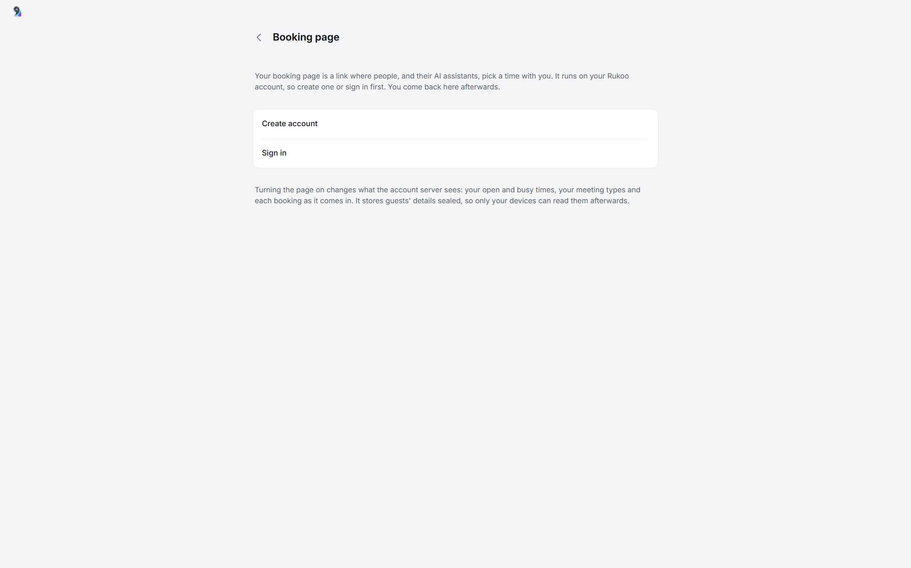

# Booking page

A booking page is a link, such as `https://meet.rukoo.io/sanne`, where other people pick a time with you. Their AI assistants can use it too: the page links to a guide written for them, and there is a JSON API and an MCP endpoint. Each booking becomes an event in your calendar, and your calendar sends the guest the invitation.

The page runs on the server of your [Rukoo account](account.md). The server offers your open times and takes bookings, also while your computer is off. It never talks to your mail or calendar provider. Rukoo on one of your computers publishes your open times, picks up the bookings and adds them to your calendar.

## What you need

- A Rukoo account. The default server, `https://rukoo.io`, takes new accounts by invite code for now. A server you run yourself works too (see [Running your own](#running-your-own)).
- A calendar the bookings can go to: a Google calendar, or a CalDAV calendar whose server sends invitations. The demo account's calendar works for trying it out, but nobody gets an invitation from it.
- Rukoo running on one computer. That computer adds the bookings to your calendar, so the invitations go out while it runs.

## Setting it up

Open Settings → Booking page. Signed out, the page explains what it needs and offers Create account and Sign in; you come back to the setup afterwards. A server without booking pages says so.



The setup is one screen:

| Field | What it is | Filled in with |
|---|---|---|
| Link | Your handle, the last part of the link: 3 to 32 lowercase letters, digits or hyphens. Rukoo checks while you type whether it's free. | Your default account's name, or the part of its address before the @ |
| Your name on the page | What guests see | Your default account's name |
| Time zone | The zone your hours are in | This computer's |
| Available hours | When guests can book | Your working hours from Settings → Calendar |
| Check these calendars for conflicts | Busy time in these calendars is never offered | The calendars that count toward availability |
| Add bookings to | The calendar that gets the events and sends the invitations. "Guests see invitations from …" names the address. | Your default account's main calendar |

Turn on publishes the page, and the screen that follows has Copy link, Preview page and Add to signature. The page starts with one meeting type, "30 minute meeting", with Google Meet when the calendar allows it.

After that, Settings → Booking page shows your link, the requests and upcoming bookings, the meeting types, the hours and the page's own settings: introduction, contact line (shown when no times are open), page language (also the language of the footer text and of the booked events' titles), time zone, link and bookings per day.

You can change the link up to 3 times in 30 days, but not while it has bookings in the future, or while a guest's cancellation hasn't reached your calendar yet. The old link forwards to the new one for 180 days.

## Meeting types

A page has up to 10 meeting types. Each has its own link, `https://meet.rukoo.io/<handle>/<name in the link>`.

| Field | Default | Choices |
|---|---|---|
| Title | "30 minute meeting" for the first, in the page's language | Up to 100 characters |
| Name in the link | `30min` for the first | Up to 40 lowercase letters, digits or hyphens; a few words such as `api` and `mcp` are reserved |
| Length | 30 minutes | 15, 20, 30, 45 or 90 minutes, or 1 to 4 hours |
| Description | Empty | Up to 500 characters, shown on the page |
| Location | Google Meet when the calendar allows it, else none | Google Meet, a [video service](#video-meetings) connected on this computer, phone call, in person, a meeting link (https) or none |
| Free time before, free time after | None | 5, 10, 15, 30, 45 or 60 minutes kept free around each booking, so guests can't book right next to your other meetings |
| Minimum notice | 4 hours | None, 30 minutes, 1, 2, 4, 8 or 12 hours, 1 or 2 days, or a week |
| How far ahead | 30 days | 7, 14, 30, 60 or 90 days |
| Start times every | Same as the length | 5, 10, 15, 20, 30 or 60 minutes |
| At most per day | No limit | 1 to 6, 8, 10, 15 or 20 |
| Needs your approval | Off | Bookings wait as requests until you accept them |
| Hide from the page | Off | Only people with the type's own link can book it |

The fields from Free time to At most per day have a section of their own, When guests can book, which is open when the editor opens. Needs your approval and Hide from the page sit under More options. In Settings → Booking page, each meeting type's row shows its length and location, these settings where they differ from the defaults, such as "15 mins free time after" or "1 day notice", and whether it needs your approval or is hidden.

A location's details (the phone number, address or meeting link) go only into the guest's invitation, unless you turn on "Show these details on the booking page". The page shows a label, such as "Phone call" or "In person, Amsterdam". Google Meet needs a Google calendar that allows Meet under Add bookings to; Google makes the Meet link when the event is created. A video service makes its own link for each booking, so that link only ever goes into the invitation, and the page shows the label or the service's name.

## Video meetings

Settings → Video meetings connects Zoom, Microsoft Teams and Jitsi Meet. On the computer that handles bookings, a connected service appears as a location in the meeting type editor, after Google Meet; other computers keep a type's service but can't choose a new one. Each booking of that type then gets a meeting of its own. The computer that handles bookings makes it when the booking becomes an event, on a Google or a CalDAV calendar, and puts its link in the event's location and on the first line of its description, so the guest's invitation has it. The account server never sees the link.

| Service | What you need | What each booking gets |
|---|---|---|
| Jitsi Meet | Nothing: turn it on | A room with a name nobody can guess, such as `https://meet.jit.si/rukoo-…`, on meet.jit.si or a Jitsi server of your own |
| Zoom | A Zoom account, and a [Zoom OAuth app](#zoom-and-teams-clients) in this copy of Rukoo | A scheduled meeting in your Zoom account |
| Microsoft Teams | A work or school account with Teams, and a [Microsoft OAuth app](#zoom-and-teams-clients) in this copy of Rukoo | A Teams meeting |

When you or the guest move a booking, its Zoom or Teams meeting moves along, and a cancelled booking's meeting is deleted. A Jitsi room has no time, so it stays as it is. On meet.jit.si the first person in a room has to sign in with Google, GitHub or Facebook before the meeting starts, and the others wait until then; a Jitsi server of your own doesn't ask this unless you set it up to.

### When a service fails

The booking always goes through. When the service can't make the meeting, the event still goes in your calendar and the guest still gets the invitation, just without a link. That happens when the service isn't connected on the computer that handles bookings, when its connection needs renewing, or when it refuses or can't be reached. A notice names the booking and the reason, with a Video meetings button: add a link to the event yourself, or cancel the booking. A move or cancellation the service couldn't follow gets a notice too. While a meeting type uses a service that can't make meetings on the computer that handles bookings, a notice says that as well.

A Zoom or Teams connection needs renewing when the service turns down the sign-in Rukoo kept. Usually someone removed Rukoo's access in the Zoom or Microsoft account, an admin withdrew it, or it went unused for too long (90 days for Zoom). Renew signs in again.

### Sign-ins stay on this computer

Rukoo signs in to Zoom and Microsoft in your browser, with OAuth 2.0 and PKCE, and keeps the refresh token on this computer, encrypted the way a Google account's is. Your Rukoo account doesn't carry it, so each computer that handles bookings connects its own services. Disconnect forgets the sign-in on this computer; Rukoo stays listed in your Zoom or Microsoft account's connected apps until you remove it there.

### Zoom and Teams clients

Zoom and Microsoft only let a registered app sign in. Like the client for [Google sign-in](mail.md#google-sign-in), none is in this repository or its builds. Without one, Settings → Video meetings says so and offers Add client file…, instead of a Connect button. Rukoo looks for a client in this order:

- environment variables: `SEM_ZOOM_CLIENT_ID`, and `SEM_ZOOM_CLIENT_SECRET` for a Zoom app with a secret; `SEM_TEAMS_CLIENT_ID`, and `SEM_TEAMS_TENANT` for a single-tenant Microsoft app;
- a file next to `google-oauth.json` in the profile (`%APPDATA%\Rukoo Mail` on Windows): `zoom-oauth.json` as `{"client_id": "...", "client_secret": "..."}`, or `teams-oauth.json` as `{"client_id": "...", "tenant": "..."}`. The secret and the tenant are optional. Add client file… writes this file for you.

For Zoom, create a General app (user-managed) in the Zoom App Marketplace:

- Set the OAuth redirect URL, and an entry in the allow list, to `http://127.0.0.1/callback`. Zoom ignores the port of a loopback address, so Rukoo can use a free one for each sign-in.
- Add the scopes `meeting:write:meeting`, `meeting:update:meeting`, `meeting:delete:meeting` and `user:read:user`.
- Rukoo always uses PKCE. A public client needs no secret; for an app with a secret, give it as above.

For Microsoft Teams, register an app in Microsoft Entra ID under App registrations:

- Supported account types: accounts in any organizational directory, or only your own. Microsoft Graph can't make a Teams meeting for a personal Microsoft account.
- Add the platform "Mobile and desktop applications" with the redirect URI `http://localhost`. Microsoft ignores the port of a localhost address.
- Turn on Allow public client flows. The app needs no secret.
- Add the delegated Microsoft Graph permissions `OnlineMeetings.ReadWrite`, `User.Read` and `offline_access`. Some organizations need an admin to consent to `OnlineMeetings.ReadWrite` first.
- Rukoo signs in through the `organizations` endpoint. For an app limited to your own directory, set the tenant to its ID or domain.

Rukoo makes Teams meetings with Graph's `onlineMeetings`, which doesn't add an Outlook event of its own, so the guest gets one invitation: the one from the calendar under Add bookings to.

## Hours and dates

By default the page follows your working hours from Settings → Calendar. Turn on "Use different hours for my booking page" for a weekly schedule of its own, with up to six ranges a day. The hours are in the page's time zone.

Dates with other hours block a whole day or set other hours for one date, up to 60 dates from today on. Block this day in the calendar's availability panel adds one too.

## Which calendars count

Busy time comes from the calendars that count toward availability. By default that is each account's main calendar plus the writable calendars you own, so read-only and subscribed calendars don't count. Change it per calendar in the calendar's menu in the sidebar, in Settings → Calendar, or under "Calendars checked for conflicts" on the booking page. A calendar someone shared with you can count too; its busy time then counts as yours. Hiding a calendar in the sidebar doesn't change whether it counts.

An event is busy when it shows as busy and you haven't declined it. Invitations you haven't answered, and ones you answered Maybe, count. An all-day event marked busy blocks the whole day in the page's time zone. Rukoo publishes busy time rounded out to the quarter hour, without titles or other details.

## Where bookings go

A booking becomes an event in the calendar under Add bookings to:

- The title is the type, your name and the guest's: "30 minute meeting: Sanne de Vries and Jane Doe". Rukoo shortens the guest's name to at most four words and 40 characters of letters, spaces, apostrophes, hyphens and periods.
- The description is the type's description and a line "Booked via" with your link.
- The location comes from the type, or Google Meet. With a video service it is the meeting's own link, which also opens the description as "Join with Zoom: …".
- The guest is invited by address. Google, or the CalDAV server, sends the invitation from your account.

The guest's note, the assistant that booked and the guest's time zone stay out of the event, so nothing a guest typed goes out in mail from your address, apart from the shortened name in the title. Rukoo shows them on the event's card, and the note and the assistant in the bookings list too.

When a new booking overlaps an event that came after Rukoo last published your times, Rukoo keeps both and shows a notice with Keep and Cancel booking.

## Requests

A type that needs your approval makes requests. A request holds its time on the page. In the calendar it shows as a dashed "Request" block at that time, and the Calendar switch at the top of the sidebar counts the open ones. Accept puts the event in your calendar, and the guest gets the invitation. Decline frees the time. A message you add shows on the guest's confirmation page, where they manage the booking; "Also email this message from …" sends it from the calendar's account as well, and is off by default.

A request you don't answer lapses 48 hours after it was made, or at its start minus the minimum notice, whichever comes first.

New bookings of any type also become requests when the page is out of date, when Rukoo couldn't read one of your calendars for 12 hours, and past the day's mail limit (see below).

## Cancelling and moving

Cancel booking, on the event's card (or `Delete`) or in the bookings list, cancels it. A message you add shows on the guest's confirmation page, and your calendar sends the cancellation.

When you move or resize a booked event in Rukoo, or move it in Google Calendar or another app, the booking moves along and the guest's confirmation page shows the new time. When you change only the length, the booking keeps its own and the card says "Length changed in your calendar". When you delete the event in another app, or the guest declines your calendar's invitation, Rukoo cancels the booking at its next check and shows a notice.

The guest cancels or picks another time from the page they saw after booking, or through the API, and can move a booking twice. Rukoo then moves or removes the event, and your calendar mails the guest.

## Email footer and composer

Settings → General → Booking link under signature adds a line with your link after your signature. The default text, in the page's language, is "Want to meet with me? Pick a time, or share this link with your agent:" followed by the link. You can write your own text; keep `{url}` where the link goes. The link shows as its address, so it also works in the plain-text part of the mail. Each account's settings can follow the general choice, turn the line on or off, or give it its own text. Add to signature, after turning the page on, switches it on.

In the composer, the calendar button has Insert booking link and Insert my free times…. The second opens a dialog with the length, period, hours and time zone, and a preview of the list it inserts. With "Add my booking link", the times follow the page's hours and the chosen type's length and minimum notice, and the link goes under them. The page may still offer fewer times, because free time around meetings and the limits per day only count there. Both work in the reading pane and in a separate compose window.

## Notifications

The computer that handles bookings shows a desktop notification for each new booking, request, move, cancellation and withdrawn request. While Rukoo's window is in front, a short notice in the window replaces it. Clicking a notification opens the event or the request in the calendar.

## One computer handles bookings

The computer that turned the page on handles it. It publishes your open times when you turn the page on or change it, a minute after a change in your calendars, and at least every 30 minutes. It checks for new bookings every minute. Settings → Booking page shows "Last updated from this computer" with how long ago.

Your other computers signed in to the same Rukoo account show the page, its requests and bookings, and say "Bookings are handled by …". Use this computer makes the computer you're on the one that handles bookings, for example when the other one stays off. Video services are connected per computer: when a meeting type, or the meeting of an upcoming booking, uses one that isn't connected on the computer you're on, the notice and the row with Use this computer say which to connect first. Requests can only be answered on the computer that handles bookings. When you delete a booked event on another computer, the booking is cancelled once the handling computer next syncs.

## When the computer is off

The server keeps offering the times it last got and takes bookings. A guest reads that the invitation comes from your calendar, usually within minutes, and that it can take longer while your computer is off. The booking holds either way. When Rukoo runs again, it adds the bookings to your calendar and the invitations go out.

- After 24 hours without an update, every type needs your approval: new bookings become requests, and guests can't move confirmed bookings. Rukoo shows "Your booking page is out of date".
- After 7 days, the page offers no times and shows your contact line.

A calendar Rukoo can't read is published from its last good busy times for 12 hours. After that every booking waits for your approval, and a notice "Couldn't check …" offers Reconnect.

## Limits that protect your mail account

Every booking makes your calendar send mail from your address. These limits keep a stranger from using your page to send a lot of it:

| What | Limit |
|---|---|
| New bookings from one network | 3 a day (per IPv4 /24 or IPv6 /64) |
| New bookings per day | Bookings per day on your page: 20 by default, 1 to 50 |
| Bookings in the future | 500 |
| Moves by the guest | 2 per booking |
| Mail | 10 changes a day that make your calendar send mail: new bookings, requests you accept, and moves and cancellations by guests |
| Requests from one address | 20 writes a minute |

Accepting a request counts too, so a day of accepted requests can use the limit up. Past the mail limit, new bookings become requests and guests can't move bookings. Requests you accept then still get their invitation. A guest can still cancel: the event leaves your calendar, and on a Google calendar no cancellation mail goes out ("No email sent to a guest"). A CalDAV server that sends invitations mails anyway, because Rukoo can't stop it.

## What the server sees and keeps

With the page on, the server keeps what it needs to offer times while your computers are off, readable:

- your name, introduction, time zone and language, the meeting types with their public location labels and the contact line;
- your open hours and the busy times within them, to the quarter hour, without titles;
- when the page was last updated.

For each booking it keeps the time, the type, the status and how it was made (the page, the JSON API or MCP). The guest's name, email, note and assistant name pass through the server readable at the moment of booking. The server then seals them with a key that only your devices have and keeps only that sealed copy. A later leak of the storage, a backup or a break-in afterwards doesn't reveal them. The operator, or someone who broke into the server at that moment, could read them then. Next to the sealed copy the server keeps a hash of the guest's manage key, and while the booking is active a hash of the guest's email bound to its time, so the same booking isn't made twice. Counts per network use a hash under a key that changes every day.

A booking is deleted 30 days after the meeting. When it is cancelled, declined or lapses, its sealed details and the email hash go at once, and the rest 30 days later. Guests read this under the booking form and in the privacy statement, at [rukoo.io/privacy](https://rukoo.io/privacy) for the default server.

Your Rukoo account holds the page's settings, its key pair, which event each booking became and its video meeting, end-to-end encrypted like every record. Export my data leaves the key pair out.

## Turning it off and deleting

Turn off Take bookings in Settings → Booking page. After you confirm, the server deletes the page and its bookings, and the link stops taking bookings. Events already booked stay in your calendar as ordinary events. Your settings stay in your account, so turning it on again starts from them. The link stays reserved for your account for 12 months.

Deleting your Rukoo account checks your password, then turns the booking page off, then deletes the account. When the page can't be turned off, the account isn't deleted either.

## For guests and their assistants

A booking page is at `https://meet.rukoo.io/<handle>`, and each meeting type at `https://meet.rukoo.io/<handle>/<type>`. The page shows the host, their introduction, the meeting types and the next open times. Pick a day and a time, then fill in your name, email and an optional note. The page is in English and Dutch, shows times in your time zone with a choice of 12 or 24 hours, and works without JavaScript. The page you get after booking shows the time in your zone and the host's, an `.ics` file, Cancel and Pick another time. Keep its address: it carries the key to your booking. The invitation comes from the host's calendar.

Assistants have four ways in, all English:

- `https://meet.rukoo.io/<handle>/llms.txt` is a guide with the rules, the meeting types, the open times of the next 7 days and how to book. The page links to it as "For AI assistants" in its footer and in its `<head>`, and asking for the page with `Accept: text/markdown` returns it. `https://meet.rukoo.io/llms.txt` explains booking pages in general.
- A prepared link opens the form filled in, for example `https://meet.rukoo.io/sanne/30min?slot=2026-11-03T09:00Z&name=Jane%20Doe&email=jane%40example.com&via=Calendar%20helper`. `slot` is the start in UTC. The user checks the details and presses Book; opening the link books nothing.
- The JSON API: `GET /<handle>/api` lists the types, `GET /<handle>/api/slots` the open times, and `POST /<handle>/api/bookings` books one. Every answer has a `message` written for the assistant to pass on.
- `https://meet.rukoo.io/mcp` is one MCP endpoint for every page, over plain HTTP POST without sign-in. Its tools are `get_meeting_types`, `find_available_times`, `book_meeting`, `get_booking`, `cancel_booking` and `reschedule_booking`; each takes `link`, the page's address or its handle.

An example with the JSON API:

```sh
# Open times for the next two weeks, written in the guest's zone
curl 'https://meet.rukoo.io/sanne/api/slots?type=30min&time_zone=Europe/London'

# Book one of them: start must be a start the slots answer listed
curl https://meet.rukoo.io/sanne/api/bookings \
  -H 'content-type: application/json' \
  -H 'Idempotency-Key: 9f1c2b7e-41d0-4a8b-b6e5-3c2a7d90e1f4' \
  -d '{"type":"30min","start":"2026-11-03T09:00:00Z","name":"Jane Doe","email":"jane@example.com","time_zone":"Europe/London","via":"Calendar helper"}'
```

The booking's answer has `manage_url` and `key`, the only way to change or cancel it later; the assistant should keep them and show its user the `privacy_url`. Through MCP, the open times of one type:

```sh
curl https://meet.rukoo.io/mcp -H 'content-type: application/json' \
  -d '{"jsonrpc":"2.0","id":1,"method":"tools/call","params":{"name":"find_available_times","arguments":{"link":"https://meet.rukoo.io/sanne/30min"}}}'
```

[server/PROTOCOL.md](../server/PROTOCOL.md#booking-pages) has every route, field and error.

## Running your own

The account server in [`server/`](../server) serves booking pages too; its `/v1/info` lists `booking` under `features`. Where the pages live depends on `BOOKING_ORIGIN`:

- Without it, the default for a server of your own, the pages live under `/meet` on the server's own address, such as `https://accounts.example/meet/<handle>`, with the MCP endpoint at `/meet/mcp`.
- With it set to an address that reaches the same Worker, such as `https://meet.example`, the pages live at the root of that address: `https://meet.example/<handle>`, with MCP at `https://meet.example/mcp` and a general guide at `https://meet.example/llms.txt`. `/meet/…` on the server's other addresses forwards there.

The default server is set up the second way, with its pages at `meet.rukoo.io`. rukoo.io itself is the website, and the account API is there too, at `https://rukoo.io/v1/…`. The pages lived at the root of rukoo.io at first, and links from then still work: every rukoo.io address that isn't the website's or the account API's forwards to the same path on meet.rukoo.io. Names the website uses, such as `assets`, `download` and `docs`, stay reserved as handles. The old address of the default server, `rukoo-account.bvdm.ai`, still answers, and its `/meet/…` links forward to meet.rukoo.io. [server/README.md](../server/README.md) explains the deployment.

## Limits

- One person per page. There are no team pages, shared meeting types or payments.
- Bookings reach your calendar, and guests their invitation, only while Rukoo runs on the computer that handles bookings.
- Microsoft calendars can't take bookings yet ([#17](https://github.com/MajesteitBart/rukoo/issues/17)), and neither can CalDAV calendars whose server doesn't send invitations.
- Booking notifications have no setting of their own yet.
- Video services are for bookings only. The calendar's own event dialog still offers just Google Meet.
- Rukoo for Android doesn't show or change the booking page. Its `get_booking_link` tool gives agents your link.
