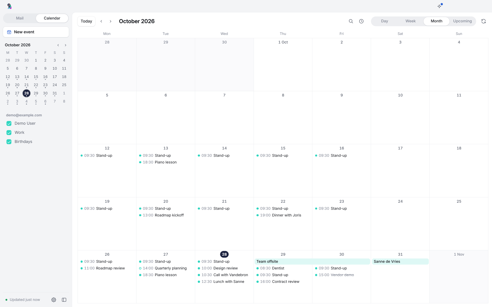
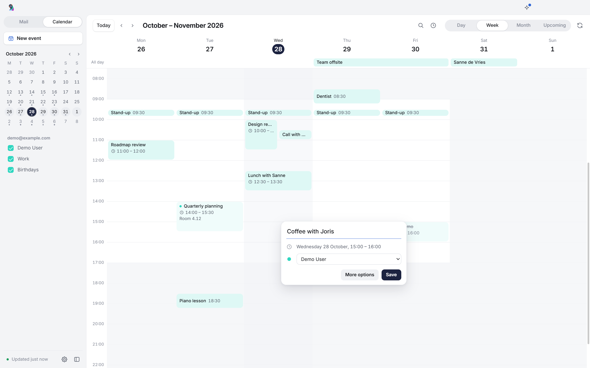
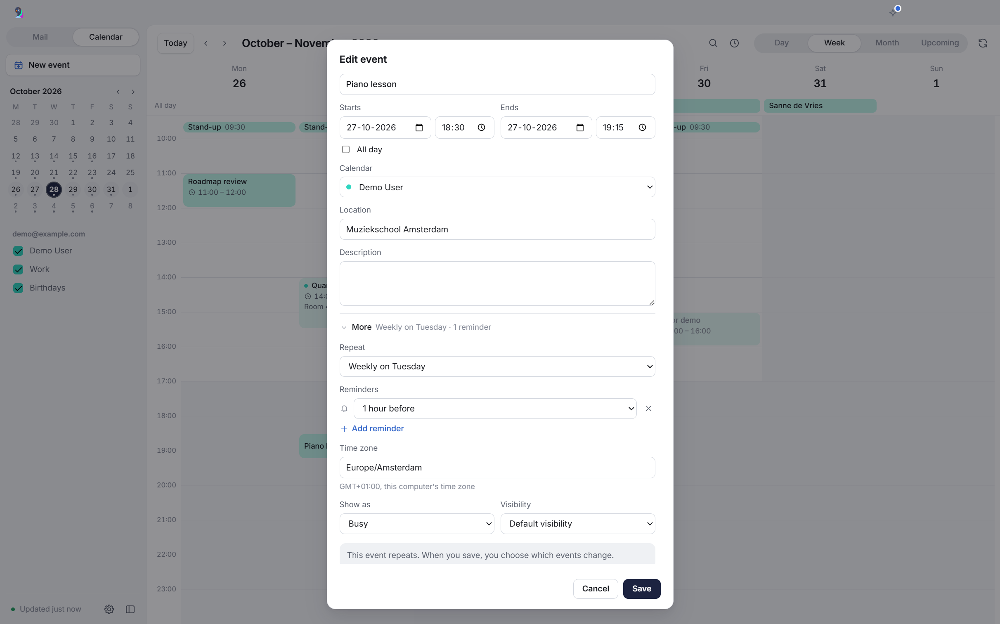
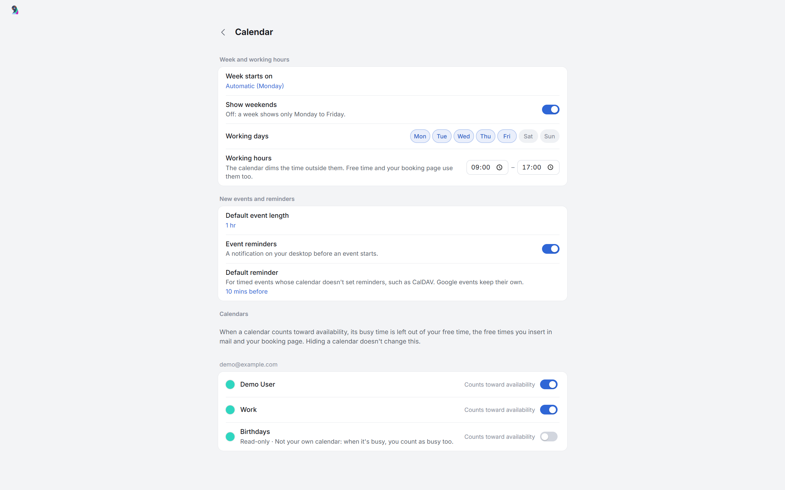

# Calendar

The switch at the top of the sidebar, or `Ctrl+2`, replaces the message list and the reader with a calendar. It shows the calendars of every Google account, and of every IMAP account with a CalDAV server in its Server settings, together. The demo account has a sample calendar.

## Views

The calendar shows a month, a week, a day or a list of what's coming. A month shows a few events per day and "+N more" for the rest. A small month at the top of the sidebar marks today and the days with events, and `G` or a click on the title goes to any date.

Each calendar can be switched on and off. It shows in the color it has in Google Calendar or on the CalDAV server, or in its account's color when it has none. Its menu in the sidebar, from the ⋯ button or a right-click, gives it one of 12 other colors or takes it back to its own.

Search (`/`) finds events by title, place, description and guests.

## Making and changing events

Drag on the week or day grid to make an event, drag an event to another time or day, or drag its bottom edge to change its length. In the month view you drag across days for an all-day event, or drag an event to another day. Undo, or `Ctrl+Z`, puts a moved or resized event back.

A click on an empty spot, or a drag, opens a small popover with the title, the calendar, guests, Google Meet and a line that names what the time overlaps. Enter saves it, and More options opens the full dialog.

The dialog adds the place and the description. Under More it has the repeat, reminders, the event's time zone, Show as (busy or free) and visibility. Picking another calendar there moves the event to another calendar of the same account. Duplicate on an event's card starts a new event with the same details.

## Guests and invitations

You add and remove guests, with suggestions from your contacts, and mark them optional. That works on Google calendars and on CalDAV calendars whose server sends the invitations. Guests only get an email from Google when you say so. You answer invitations with Yes, Maybe or No. Google calendars that allow it get a Google Meet switch, and the event's card a button to join the call.

## Repeats

Events repeat every day, every weekday, weekly, monthly on a date or on the first to fourth or last weekday, yearly, or by your own rule with an interval, weekdays and an end. Changing, moving or deleting one occurrence asks whether that goes for this event, this and following events, or all events. A rule the dialog can't edit shows as "Custom rule, kept" and stays as it is.

## Reminders

An event takes up to five reminders, from the start to a week before. All-day events take them at 09:00 the day before or up to a week before. CalDAV and demo calendars also take one at 09:00 on the day itself, which Google calendars can't store.

Rukoo shows reminders as desktop notifications, also while its window is open, with several at once in one notification. A click opens the event. Settings → Calendar turns them off and sets a default reminder for timed events whose calendar sets none, such as CalDAV events without an alarm.

Reminders show for the calendars you switched on, while Rukoo runs. `data\reminders.json` remembers which ones showed, so a restart doesn't repeat them.

## Availability

The availability panel (`A`) lists your open time across the calendars that count toward availability. You choose a length of 15 to 90 minutes, a period (this week, next week or the next 14 days), the hours (your working hours, your booking page's hours or any time) and a time zone. While the panel is open the grid shows the same open time. It names the accounts it couldn't read instead of treating them as free.

From the panel you copy the times as text, copy your booking link or block a day on your [booking page](booking.md).

## Settings

Settings → Calendar has the first day of the week, weekends, working days and hours (the grid dims the time outside them) and the default event length. Per calendar it sets the color and whether the calendar counts toward your availability.

## Keyboard

| Key | Action |
| --- | --- |
| `Ctrl+1` | Back to the mail |
| `T` | Today |
| `←`, `→` (or `K`, `J`) | Previous and next month, week or day |
| `M`, `W`, `D`, `U` | Month, week, day, upcoming |
| `G` | Go to date |
| `/` | Search |
| `A` | Availability |
| `N`, `C` or `Ctrl+N` | New event |
| `Ctrl+Z` | Undo the last move or resize |
| `F5` | Sync |
| `Esc` | Cancel a drag, or close a popover, the search or the panel |

With an event's card open, `E` edits, `Delete` deletes (or cancels a booking) and `Esc` closes. In the small month in the sidebar, the arrow keys, `Page Up`/`Page Down` and `Home`/`End` move between days, and `Enter` opens one.

## Google calendars

The calendar asks Google for two scopes beyond mail: `calendar.calendarlist.readonly` and `calendar.events`. They only work once the Google Calendar API is turned on in the Cloud project of your [OAuth client](mail.md#google-sign-in): APIs & Services → Library → Google Calendar API → Enable. Until then the calendar shows Google's error with a button to that page.

Google's consent screen lets you leave the calendar out. Mail still works, and the calendar offers "Connect calendar" for that account. Accounts added before the calendar existed sign in once more through the same button, and their mail access stays as it was.

Guests, repeats, reminders and Google Meet go through `calendar.events`. The calendar list gives each calendar's color, its default reminders and whether it allows Meet. Google can take a few seconds to make a new Meet link, so Rukoo asks for it again after 2, 5 and 15 seconds.

Answering an invitation lets Google tell the organizer. A change or deletion only applies to the version of the event you saw. When the event changed in Google Calendar in the meantime, Rukoo shows the latest version and keeps your edits on top of it, so the next Save doesn't overwrite the other change.

Events Google made itself, such as a flight Gmail found or a contact's birthday, can be deleted but not edited, because Google doesn't take a new title or time for them.

Rukoo doesn't show whether guests are free when you invite them. That needs Google's `calendar.freebusy` scope, and asking for one more scope would send every Google account through sign-in again.

## CalDAV calendars

CalDAV calendars work for IMAP accounts whose provider offers CalDAV. Enter the CalDAV address with the manual server settings when you add the account, or later in its Server settings. A host name such as `caldav.example.com` is enough when the server supports `/.well-known/caldav`.

Rukoo signs in with the username and password of the account's mail servers, and only over https, except for a server on the same PC. It sends them only to the host you entered. When the server sends Rukoo to another host, the calendar names that host so you can enter it yourself if you trust it. Rukoo checks the address when you add the account or save Server settings, saves nothing until it works, and remembers where the server keeps your calendars.

Calendars get the color and time zone the server gives them. Rukoo reads each event whole and works out the occurrences of a recurring event itself, in the event's own time zone. New timed events carry their time zone's name (TZID) and its definition (VTIMEZONE), so a repeat added later keeps its clock time across daylight saving changes. A single event in the hour the clocks go back is written in UTC instead, because a zone name can't say which of the two times it means.

Changing or deleting one occurrence writes an exception into the series. As with Google, every change, including deleting a whole series, only applies to the version you saw. Moving an event to another calendar uses the server's WebDAV MOVE; where the server doesn't offer it, only events without guests can move. A series that another app changed from one occurrence onwards (RANGE=THISANDFUTURE) shows that change but can't be changed from Rukoo. Task lists on the same server are left out.

Guests on CalDAV need a server that sends the invitations itself, which it says with `calendar-auto-schedule`. Where it does, you add, remove and change guests, the server emails them about every change without Rukoo asking first, and you answer invitations with Yes, Maybe or No.

Elsewhere you can't add guests. Events with guests other than you, or with a room or resource booked, can't be changed or deleted from Rukoo, because the server might email the guests or change the booking without asking. The card shows your answer without buttons. When a server gets this wrong, set "Invitations to guests" in the account's Server settings to "The server sends them" or "The server doesn't send them". Automatic follows the server.

## Time zones and caching

The calendar shows times in the PC's time zone. An event keeps its own time zone, which you can change under More in its dialog.

Rukoo keeps the weeks you looked at in `%APPDATA%\Rukoo Mail\data\calendar` and fetches them again at every sync. Search reaches a year back and a year ahead in Google calendars, and from 30 days back to 180 days ahead in the others.

## Limits

- Calendars of Microsoft accounts aren't supported yet ([#17](https://github.com/MajesteitBart/rukoo/issues/17)).
- Guests can't be added on a CalDAV calendar whose server doesn't send invitations.
- An invitation in the mail shows as an ordinary email, without buttons to answer it. Answer it on the event in the calendar.
- A booking reaches your calendar, and the guest the invitation, when Rukoo runs on the computer that handles your booking page. Until then the server holds it. See [Booking page](booking.md#one-computer-handles-bookings).
- Rukoo for Android has no calendar yet.

## Screenshots

An invitation that waits for an answer.

The month view, with each day's events by start time.

A click on the grid starts a new event in a popover beside it.

The full dialog of a weekly event, with More open on its repeat, reminder and time zone.

Availability lists your open time for the next 14 days and marks it on the grid.

Settings → Calendar: the week, working hours, reminders and the calendars that count toward availability.

