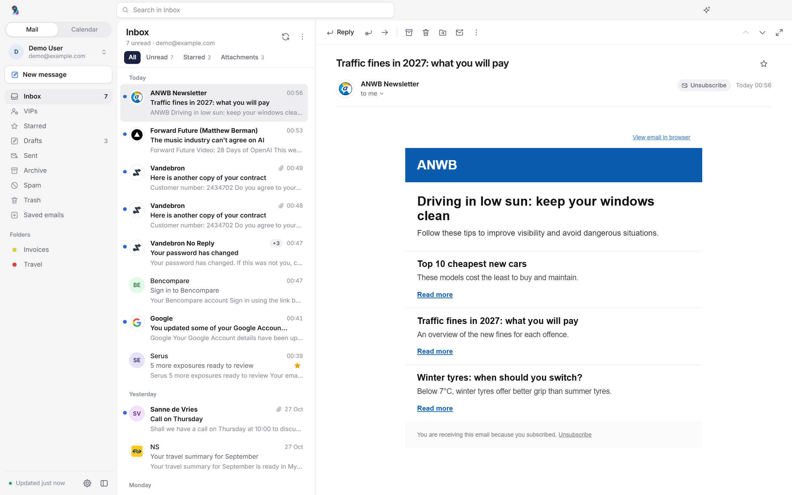
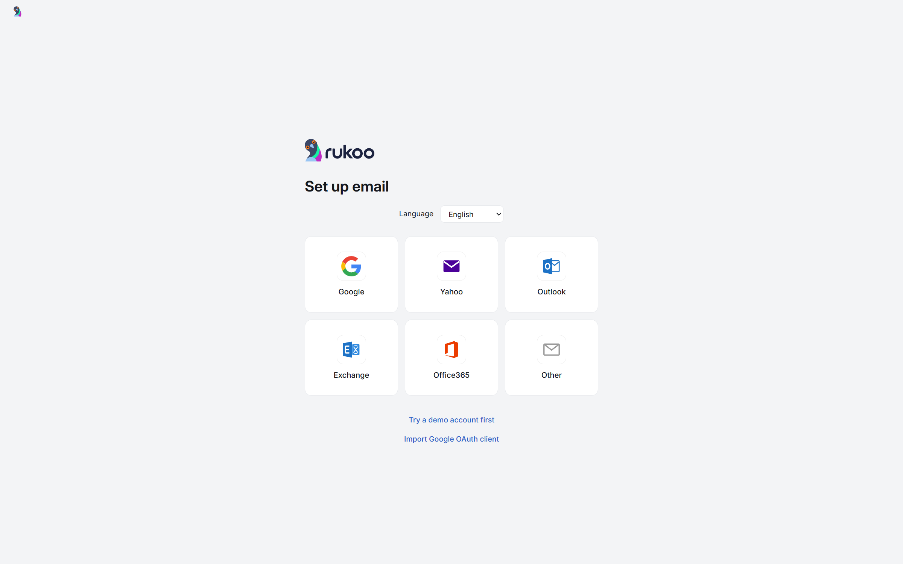
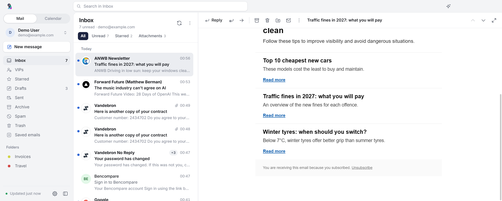
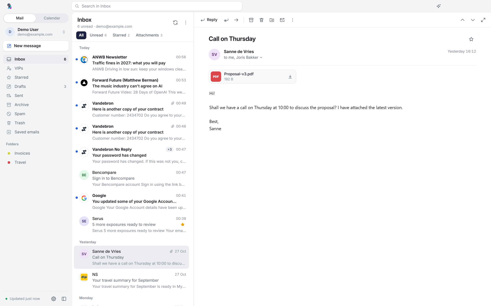
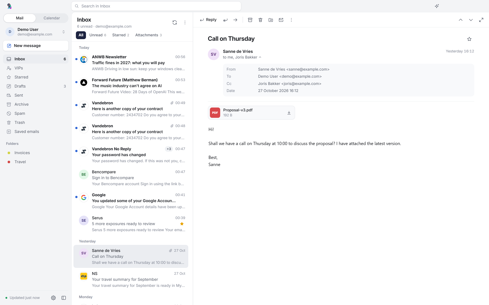
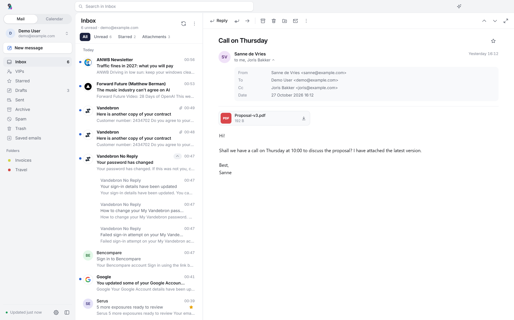
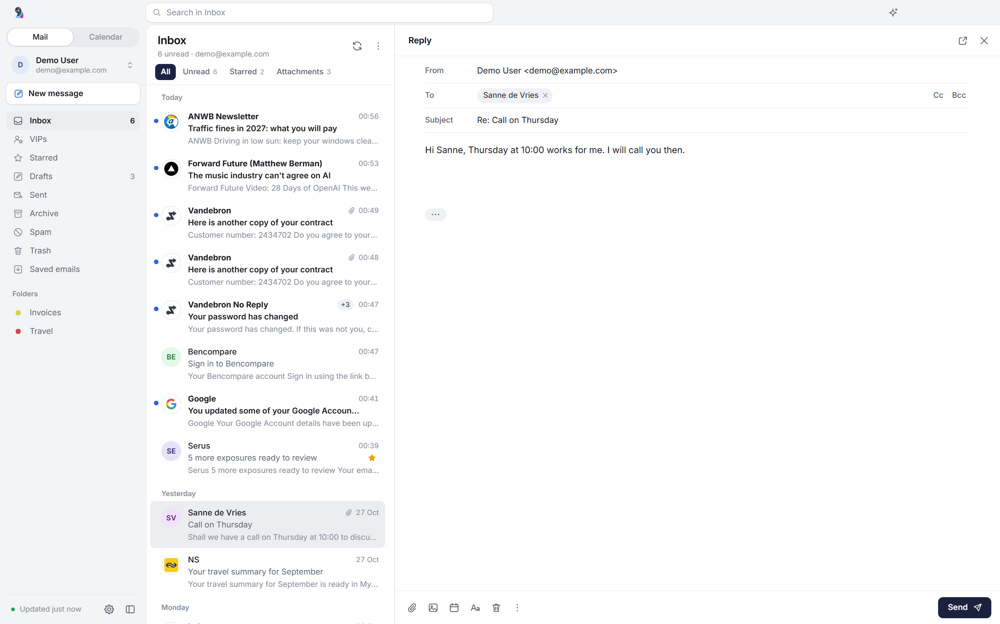
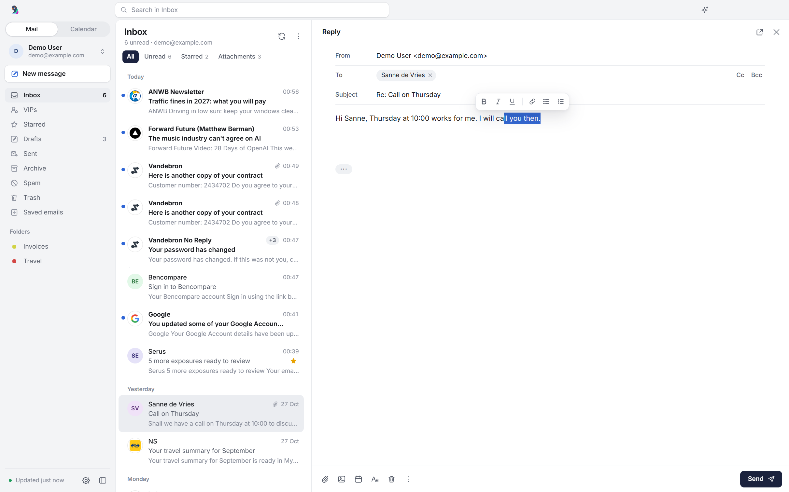
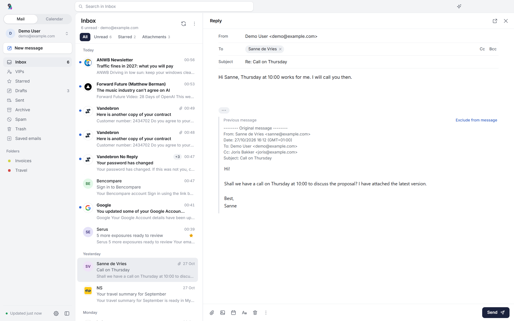
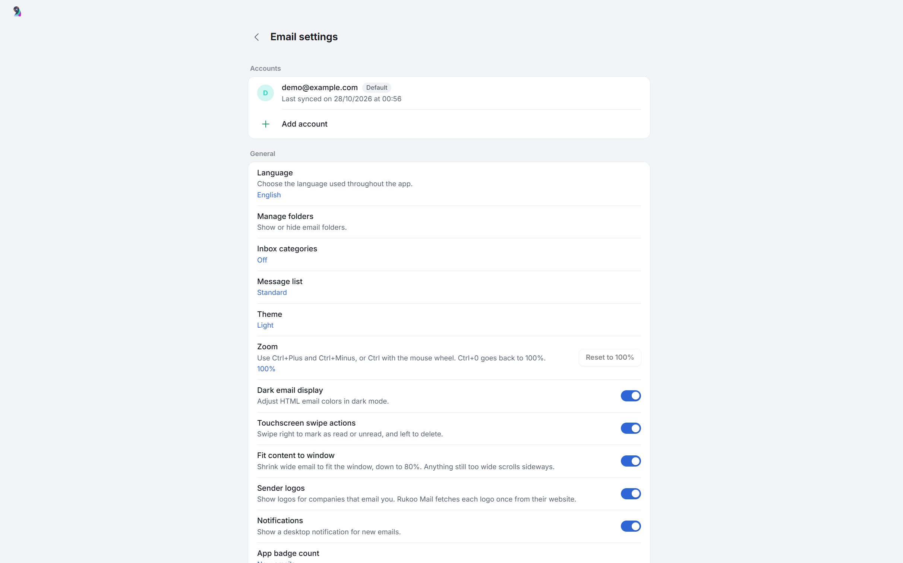

# Mail in Rukoo

Rukoo reads and sends mail over IMAP and SMTP. Gmail and Google Workspace sign in with Google. Other providers use a password or an app password. The demo account has English sample mail and needs no credentials.

## Accounts

"Sign in with Google" works for Gmail and Google Workspace. You sign in in your browser (OAuth 2.0 with PKCE), after which IMAP and SMTP use XOAUTH2. You don't need an app password.

Yahoo, Outlook, Exchange, Office365 and any other provider connect over IMAP, with preset servers per provider or manual IMAP and SMTP settings. Yahoo, and Gmail without Google sign-in, only accept an app password. Their setup form says so above the password field and links to the page where you create one.

Microsoft has switched off password sign-in for most Outlook.com and many Microsoft 365 mailboxes. Those need OAuth, which Rukoo doesn't implement yet. Exchange works when the server offers IMAP and SMTP; Exchange ActiveSync isn't supported.

The account switcher at the top of the sidebar lists each account by its display name, with the address underneath. "All accounts" is a unified inbox, where each message shows its account as a dot in the account's color on the sender's picture. A new message started there, from the tray or from an email link uses the default account. Settings marks it with a badge and lets you change it beside each account. A new message from another account offers Use as default account beside From.

### Google sign-in

Google sign-in needs an OAuth client of type "Desktop app" from Google Cloud. The client isn't in this repository, so released builds don't have one either. Rukoo looks for it in this order:

- the `SEM_GOOGLE_CLIENT_ID` and `SEM_GOOGLE_CLIENT_SECRET` environment variables;
- `%APPDATA%\Rukoo Mail\google-oauth.json`, as `{"client_id": ..., "client_secret": ...}` or Google's own download format. "Import Google OAuth client" on the setup screen writes this file for you.

While the client's consent screen is unverified, Google shows a warning before you can continue. A Workspace admin may also have to trust the app for the `https://mail.google.com/` scope. The calendar needs two more scopes and the Google Calendar API; see [Google calendars](calendar.md#google-calendars).

## The sidebar and the list

The sidebar has Inbox, VIPs, Starred, Drafts, Sent, Archive, Spam, Trash, Saved emails and your own folders. [Inbox categories](categories.md) show under Inbox. The sidebar collapses to an icon rail, and does so by itself in narrow windows. The "+" next to Folders makes a new folder.

Search sits in the title bar and covers the current folder, the current account or all accounts. Quick filters above the list show Unread, Starred and Attachments.

The list shows sender logos for companies and initials for people. Previews skip "view in your browser" lines and greetings. A run of three or more messages from one sender folds into a single row, marked "+3" for three more. The list has a standard and a compact density, and offers sorting, mark all as read and empty Trash.

The newest message opens when you start the app or switch folders. It stays unread until you open it yourself.

Ctrl+click and Shift+click select several messages for one action. Right-click opens a menu with shortcuts, and you can drag messages onto a folder. Deleting, archiving and moving can be undone from the notice that follows, or with `Ctrl+Z`.

## Reading

The reading pane has its actions in a toolbar at the top, and the subject moves into it when you scroll. The header reads "to me, Joris Bakker" and opens the full details on request.

Newsletters get an Unsubscribe button that uses their List-Unsubscribe link, one-click where the sender supports it. Attachments show as compact cards with image thumbnails and "Save all".

The mail keeps a readable width, and the grey canvas of newsletters is cleared. Mail wider than the pane shrinks to no less than 80% and scrolls sideways for the rest. With "Fit content to window" off, it scrolls sideways at full size.

HTML mail renders in a sandboxed frame with scripts stripped. In dark mode Rukoo recolours HTML mail; you can switch that off.

Right-click in an email for a menu that fits what's under the pointer. A link opens in the browser or copies its address; a mailto: link starts a new message or copies the email address. An image opens in the default image viewer, copies to the clipboard or saves as a file. Inline images work too, and so do images on the web, as long as they're PNG, JPEG, GIF, WebP, BMP or ICO. SVG images are left out because they can carry script. Selected text copies as it does with `Ctrl+C`, and Select all selects the whole email. The quoted email in a reply has the same menu. In the dark theme, plain-text mail copies as plain text, so it doesn't paste as light grey text on a white page.

## Writing

New mail, replies and forwards open in the reading pane, with Send at the bottom right. A button moves the message into a window of its own, which remembers its size and position. Formatting appears above selected text, or as a row you switch on. Earlier mail in a reply waits behind a "···" pill and can be left out. The composer has recipient autocomplete, Cc and Bcc, attachments by picker or drag and drop, links and inline images.

Drafts save to the server's Drafts folder while you write. Opening another message keeps what you wrote as a draft. Closing with unsaved changes asks whether to keep them.

Signatures are plain text or formatted. Paste one from another mail app or a web page, write it in Settings with bold, links, colors and images, or edit its HTML. There is a general signature and one per account, each with a preview. Rukoo cleans pasted HTML: scripts, forms, frames, event handlers and unsafe links are removed. Images in a signature, or inserted in a message, are sent as inline attachments, so mail apps that drop embedded image data still show them. Images from the web stay links to the web. The plain-text part of the mail carries the signature as text.

The composer's calendar button inserts your [booking link](booking.md) or a list of your free times, and a line under your signature can carry the link.

Type `@` and a name in the text to mention someone. The suggestions start with the people in the thread: the email's recipients, the people on the email you answer, and the rest of the conversation as far as Rukoo has synced it. People from the rest of your synced mail come after them. Arrow keys move through the list, and Enter or Tab picks. Picking someone puts "@Name" in the text, or the part of the address before the @ for someone without a name, and adds them to Cc if they aren't on the email yet. Someone already in To, Cc or Bcc only gets the mention. Deleting a mention leaves the recipients as they are. An email address you type, quoted mail and your signature never open the list. A comma or colon typed right after a mention replaces the space after it, so "@Bob:" comes out as written.

In the sent email a mention is a mailto: link to that person, as Outlook and Gmail send them, and the plain-text part reads "@Name". Only people in To or Cc get the link. A mention of someone in Bcc goes out as plain text without their address, so the other recipients don't see it. Saved drafts keep their mentions.

## Swipe, quick actions and keyboard

Settings → General → Swipe and quick actions chooses what a swipe right and a swipe left do on touch screens: mark read or unread, archive, delete, star, or move to a folder or a category. It also adds up to four buttons that show on an email under the mouse.

Settings → General → Keyboard shortcuts picks the scheme of the mail app you know: Rukoo's own, Gmail, Outlook, Apple Mail or Thunderbird. Every scheme archives, stars and moves to a category with a key. Menus and tooltips show the keys of the scheme you chose.

Rukoo's own keys in the main window:

| Key | Action |
| --- | --- |
| `Ctrl+N` | New mail |
| `Ctrl+R`, `Ctrl+Shift+R` | Reply, reply all |
| `Ctrl+F` | Forward |
| `Ctrl+E` or `/` | Search |
| `↑`, `↓` | Previous and next message |
| `Shift+↑`, `Shift+↓` | Extend the selection |
| `Ctrl+A` | Select all |
| `Ctrl+Q`, `Ctrl+U` | Mark read, mark unread |
| `Ctrl+Shift+V` | Move |
| `Delete` | Delete |
| `Ctrl+Z` | Undo |
| `Ctrl+P` | Print |
| `F5` | Sync |
| `Esc` | Clear the selection or search |

While writing: `Ctrl+Enter` sends, `Ctrl+S` saves the draft, `Ctrl+K` inserts a link and `Esc` closes.

Zoom runs from 80% to 200%. In every window, also with the focus inside an email, `Ctrl+Plus` (or `Ctrl+=`) zooms in, `Ctrl+Minus` zooms out and `Ctrl+0` goes back to 100%. Ctrl and the mouse wheel and the numpad keys work too. The main window and the compose windows share one level, and Rukoo remembers it. On a Mac, use Command instead of Ctrl; see [macOS](platforms.md#macos-experimental).

## Email links

Rukoo opens `mailto:` links from your browser and other apps. A link opens a filled-in compose window with its To, Cc, Bcc, subject and text. Rukoo never attaches files a link names, and you send the message yourself.

What the link filled in counts as unsaved: closing the window asks whether to keep it, and it saves to Drafts after a few seconds. A link with only an address closes without asking. While Rukoo runs, only the compose window comes up, also when the main window is in the tray. Before you add an account, the compose window says so and becomes the message once you have one. A link in a message opens the same way.

How Rukoo becomes the app for email links depends on the system: see [Windows](platforms.md#windows), [macOS](platforms.md#macos-experimental) and [Linux](platforms.md#linux).

## Notifications and settings

Rukoo shows desktop notifications for new mail. Windows also shows a count badge on the taskbar icon, and macOS on the Dock icon. By default it counts the mail that came in since you last had Rukoo's window in front; an email stops counting once it's read or leaves Inbox. On Windows, closing the window keeps Rukoo running in the tray; see [Windows](platforms.md#windows).

Settings has language, theme, zoom, list density, swipe and quick actions, keyboard shortcuts, fit content to the window, sender logos, notifications, taskbar badge, sync interval, close and minimize to the tray, the app for email links, signature (none by default, plain text or formatted) and the booking link under it, spam addresses, VIPs and folder visibility. Settings → Calendar and Settings → Booking page sit in a group of their own. Rukoo also remembers the list width, the sidebar state and where the windows were.

## What Rukoo keeps on your computer

Each folder keeps the newest 300 messages (inbox) or 100 (other folders) locally. Older mail stays on the server, but the inbox's unread count still includes it: each sync asks the server how many of the older inbox messages are unread. The sidebar's Inbox count, the account menu, the tray tooltip and a taskbar or Dock badge set to count unread mail use that total.

The list itself only holds those 300 messages, so the Unread filter counts them. The list's header shows both numbers, for example "7 unread, 434 more in older mail". Older mail from senders you marked as spam counts too, because Rukoo doesn't have its headers. Mark all as read only reaches the 300 messages Rukoo keeps.

The list holds headers and a short preview, and a message's full content downloads when you open it. After each sync Rukoo also downloads the newest 30 inbox messages of up to 1 MB each, so they open without waiting for the server. Those downloads don't mark anything read, and Rukoo deletes a downloaded message once it drops out of the folders it keeps. A message that isn't downloaded yet comes over a second connection to the server, so opening it doesn't wait for a running sync. A sync only asks for the flags of messages Rukoo already has.

Sender logos are the icons companies publish on their own websites. Rukoo fetches one per sender domain, caches it in `%APPDATA%\Rukoo Mail\logos` and tries a missing one again after a week. That request tells the company's web server that someone opened mail from it, much like loading images in the mail itself. Mail from free-mail providers such as Gmail or Ziggo never triggers a request. You can switch logos off in Settings.

Passwords and Google refresh tokens use Electron's `safeStorage`: Windows DPAPI on Windows, Keychain on macOS, and GNOME Keyring or KWallet on Linux. macOS and Linux refuse to save new credentials when secure system storage is unavailable; demo mail still works.

Account data and the message cache live in `%APPDATA%\Rukoo Mail\data` on Windows. [macOS](platforms.md#macos-experimental) and [Linux](platforms.md#linux) use their own profile folders. Earlier builds, named "E-mail", used `%APPDATA%\E-mail`; Rukoo moves that folder on first launch.

## Screenshots

These use the English interface and the demo account. The same screens in dark mode are in [screenshots/dark](screenshots/dark).

The first run.

Scrolled down, the subject moves into the toolbar.

Personal mail reads "to me, Joris Bakker", with the attachment as a card.

The full sender and recipient details, on request.

Four messages from Vandebron No Reply, unfolded from one row.

A reply in the reading pane, with the earlier mail behind "···".

Formatting appears above selected text.

The earlier mail, with "Exclude from message" to leave it out.

Settings.

